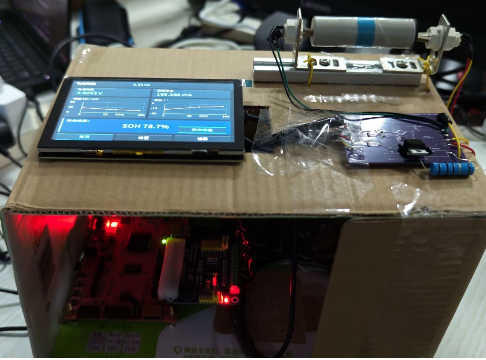
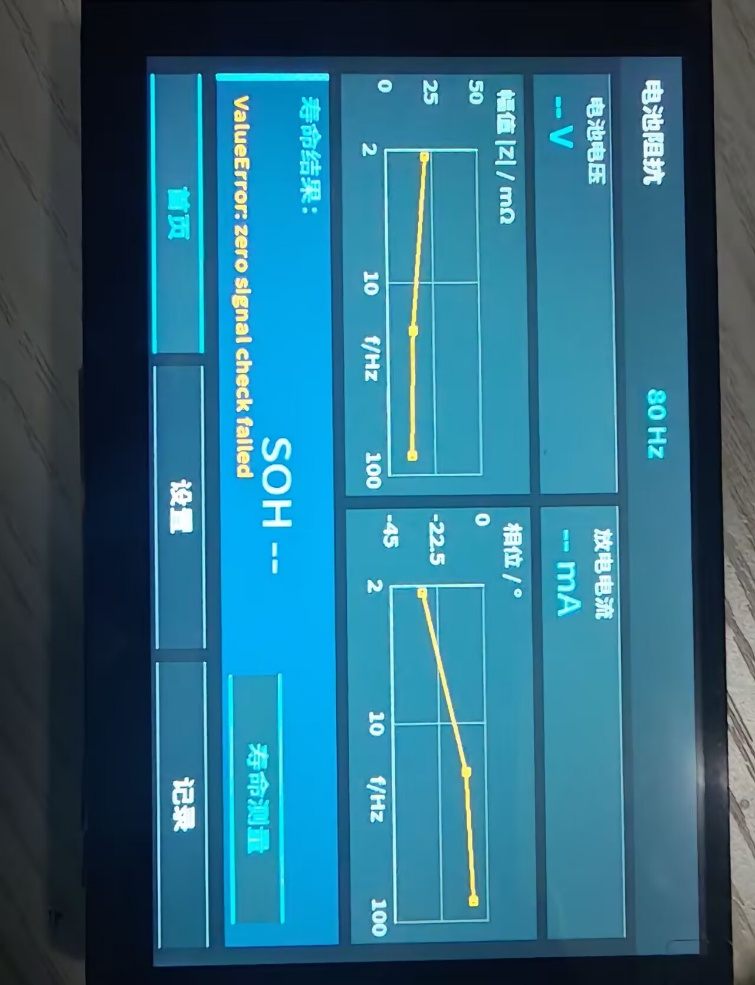

# 技术文档

[下载Word匿名提交版](technical_report.docx) · 以下为同一报告的Markdown阅读版，保留正文与图表内容，排版随网页调整。

## 目录

- [摘要](#摘要)
- [第一部分 作品概述](#第一部分-作品概述)
  - [1.1 功能与特性](#11-功能与特性)
  - [1.2 应用领域](#12-应用领域)
  - [1.3 主要技术特点](#13-主要技术特点)
  - [1.4 主要性能指标](#14-主要性能指标)
  - [1.5 主要创新点](#15-主要创新点)
  - [1.6 设计流程](#16-设计流程)
- [第二部分 系统组成及功能说明](#第二部分-系统组成及功能说明)
  - [2.1 整体介绍](#21-整体介绍)
  - [2.2 硬件系统介绍](#22-硬件系统介绍)
  - [2.3 软件系统介绍](#23-软件系统介绍)
- [第三部分 完成情况及性能参数](#第三部分-完成情况及性能参数)
  - [3.1 整体介绍](#31-整体介绍)
  - [3.2 工程成果](#32-工程成果)
  - [3.3 特性成果](#33-特性成果)
  - [3.4 系统复现与操作说明](#34-系统复现与操作说明)
- [第四部分 总结](#第四部分-总结)
  - [4.1 可扩展之处](#41-可扩展之处)
  - [4.2 大模型协作记录](#42-大模型协作记录)
  - [4.3 心得体会](#43-心得体会)
- [第五部分 参考文献](#第五部分-参考文献)

## 摘要

随着新能源汽车与规模化储能电站的爆发式增长，动力与储能锂离子电池在全生命周期内的健康状态（State of Health, SOH）与寿命衰减评估已成为保障系统安全性与运行经济性的关键技术瓶颈。传统的电池健康状态监测主要通过实验室电化学阻抗谱进行全频扫描，虽信息丰富但耗时数十分钟且设备昂贵笨重，无法直接应用于工业产线快检及在线巡检场景。本项目拟通过Xilinx Zynq-7000平台，实现一种基于锁相放大的便携式EIS系统。项目具体工作如下：

（1）前期阻抗测量与算法验证。本项目从通用阻抗测量出发，首先绘制阻抗样品板原理图与PCB，以R、RC、RL、RLC等可配置无源网络为测试对象，开发参考电阻法、数字锁相解调、等效电路识别及参数估计算法。通过与理论阻抗进行对照，检查采样、幅相解调、校准和参数估计结果，为后续电池测量建立硬件与算法基础。

（2）电池阻抗测量与健康评估方案。在前期工作基础上，针对电池直流偏置和毫欧级交流响应，设计四线开尔文微扰动前端Battery_EIS_REV_A，以10Ω负载、MOSFET和0.1Ω分流电阻构建受控放电支路，使用ADS1256的多路复用差分输入进行电压与电流的分时采样\[10\]。系统采用具有处理系统（PS）和可编程逻辑（PL）的Zynq-7000平台\[12\]，由PL端完成数字锁相与相干累积，PS端完成时延补偿、校准修正和复阻抗解算。参考阻抗谱结合机器学习进行电池退化分析的研究思路\[2\]，当前系统采集80Hz、17.8Hz和2.16Hz三个频点，每点重复两次；SOH模型采用其中2.16Hz、17.8Hz的实部与虚部，共四维特征，并对数据不完整、特征越界等情况执行拒判。

（3）轻量化SOH模型与评估。当前程序在公开数据集的回溯性分组交叉验证中，KIT数据集随机森林模型的SOH预测MAE为1.647个百分点，P95绝对误差为4.397个百分点；LIB数据集Ridge模型的MAE为2.477个百分点。板端三频测量记录耗时18.14秒。

（4）嵌入式软件与交互实现。系统基于Linux系统编程方法\[16\]，构建硬件访问、采集控制、阻抗处理、模型调用和界面记录相结合的软件流程。界面线程负责触屏操作、状态刷新与曲线显示，测量工作线程负责初始化、零激励预检、三频采集、数据读回、校正分析及会话保存，并支持取消、超时处理和异常停止。800×600触屏界面设置首页、设置、记录三个页面。

本项目依据国家标准GB/T 31484-2015\[1\]对于动力电池循环寿命衰减规律的规范，打通了“受控微放电激励→FPGA相干锁相累积→PS相随时延补偿与三层校准→轻量机器学习SOH估计→端侧多模交互”的完整软硬件闭环，在极低物料成本下验证了嵌入式电化学阻抗快检技术的可行性，为动力电池梯次利用筛查、储能电站在线巡检和新一代智能BMS提供了高可靠、可工程化落地的技术方案。

## 第一部分 作品概述

### 1.1 功能与特性

<figure>

<figcaption>
图 1 作品全貌图(1)
</figcaption>
</figure>

<figure>

<figcaption>
图 2作品全貌图（2）
</figcaption>
</figure>

本作品是一套基于Xilinx Zynq-7000异构平台的便携式电池电化学阻抗测量与健康状态评估系统\[12\]。系统由电池四线开尔文接口、微扰动激励与采样前端、FPGA数字锁相处理模块、ARM阻抗分析与SOH评估模块，以及触屏交互与数据记录模块组成。作品在前期阻抗样品板设计和RLC网络测量算法验证的基础上，结合复阻抗与等效电路分析方法\[14\]，将检测对象扩展到电池，通过获取电芯端口的交流阻抗特征，为健康状态与寿命衰减分析提供依据。

测量时，系统通过受控脉冲放电产生微扰动，利用ADS1256的多路复用差分输入，分时采集电池端电压与分流电阻电压\[10\]。PL端完成采样时序控制、正交参考生成和相干锁相累积，PS端完成时延补偿、校准修正及复阻抗解算，形成软硬件协同的测量链路。参考阻抗谱结合机器学习开展电池状态评估的研究思路\[2\]，当前程序采集80Hz、17.8Hz和2.16Hz三个频点，并使用其中2.16Hz、17.8Hz的阻抗实部与虚部构成四维特征，通过轻量模型进行SOH估计。

系统在Linux环境下组织测量任务、界面刷新与文件记录，相关实现参考Linux系统编程方法\[16\]。系统配备800×600触屏界面，设置首页、设置和记录三个页面，支持测量控制、阻抗幅相曲线显示、SOH结果展示及历史记录查询。程序结合零激励预检、信号质量检查、超时处理和模型输入范围检查，在测量异常或数据不满足评估条件时停止相关任务或拒绝输出SOH，使测量、分析、显示与记录相互衔接。

<figure>

<figcaption>
图 3 系统核心功能模块协同工作示意图
</figcaption>
</figure>

| 核心功能 | 实现特性与工程指标 |
|----|----|
| 微扰动阻抗解调 | 支持2~100Hz单极性受控脉冲微扰动放电阻抗提取，解调分辨率优于1mΩ |
| 双频超快检测 | 基于Gasper等\[6\]低频阻抗敏感性机理优选2.16Hz与17.8Hz双特征频点，测量窗口仅18.14s，整机\<20s完成分析。 |
| 四线开尔文接口 | 四线Kelvin物理隔离测试架构（F+/S+/S-/F-），彻底消除导线阻抗与接触电阻对毫欧级阻抗测量的干扰。 |
| 异构数字锁相 | PL端实现硬件DDS与正余弦同频相干相乘累积\[15\]，PS端消除非同时多路复用ADC相位差，兼具硬件实时性与算法灵活性。 |
| 轻量化SOH估计 | 基于四维阻抗特征向量（双频Re与有符号Im），嵌入式运行Ridge/随机森林轻量模型，SOH预测MAE低至1.647%。 |

表 1系统核心功能与工程特性一览表

### 1.2 应用领域

（1）动力电池产线出厂质检与梯次利用快速分选：根据GB/T 31484-2015《电动汽车用锂离子蓄电池循环寿命要求及试验方法》\[1\]，电池容量衰减至额定容量80%即达到退役寿命终点。在动力电池电芯制造末端，本系统可在14秒内快速完成极耳焊接质量、内部微短路及出厂交流内阻的精密检测；在退役动力电池梯次利用场景中，系统能够迅速评估海量退役电芯的实际健康度（SOH），自动完成一致性分档与残值评估，大幅降低分选测试时间与电能消耗。

（2）储能电站与新能源汽车原位健康巡检：储能电站由数万节电芯串并联组成，传统停机离线容量标定代价高昂。许思维等\[8\]指出原位在线快速阻抗筛查能精准定位“短板电芯”。本系统微扰动放电无需充满放空电芯，可在运行维护间隙对电池模组进行原位无损快速阻抗筛查，提前预警热失控安全隐患，保障储能系统本质安全。

（3）嵌入式电化学与人工智能科研教学平台：系统覆盖从电路调理、FPGA数字逻辑设计、SPI总线协议、数字锁相放大、Linux驱动开发到轻量机器学习部署的全栈技术链，可直接作为电子信息工程、自动化及新能源汽车工程专业的综合创新实训与科研实验平台，培养具备端侧软硬件协同全栈能力的复合型人才。

### 1.3 主要技术特点

（1）软硬件协同的Zynq异构计算架构：充分利用Zynq-7000 SoC\[12\]的PS-PL协同优势，参考严豪等\[13\]提出的边缘软硬件协同架构，PL端FPGA逻辑负责纳秒级精度的ADS1256\[10\] SPI引擎控制、DDS正余弦生成及长达数秒的正弦/余弦同频相干相乘硬件累积（避免溢出与截断误差）；PS端双核ARM Cortex-A9负责非同时采样相位延迟修正、浮点复阻抗解算、三层校准映射、轻量化AI模型推理及UI图形渲染，实现算力、实时性与功耗的最优平衡。

（2）通用PYNQ Skill提炼与工程复用：本项目将阻抗测量与电池健康状态评估系统开发过程中积累的经验，提炼为以下五个Skill：

① 测量与寄存器一致性Skill。 针对测量过程中可能出现的寄存器状态、采样数据与当前任务不对应问题，提炼测量快照、数据新鲜度及故障状态核对规则。验证时检查任务编号、采样状态和结果归属是否一致，并确认异常数据不会进入后续分析。其适用边界是数字接口与数据一致性检查，不能替代模拟前端校准或证明阻抗绝对精度。

② 低频长窗口采集Skill。 在将测量频点扩展至低频的过程中，发现原有采集窗口和缓存容量不能直接满足低频多周期观测需求，由此提炼频率、周期数、窗口长度、缓存容量与超时预算的联合检查方法。通过核对原始样本数量、时间戳、窗口完整性和超时处理验证配置是否匹配。该Skill适用于长窗口采集任务，但采集周期数满足要求并不等于电池已充分稳定，仍需结合实际信号验证。

③ 软硬协同推理与拒判Skill。 针对公开数据模型与实物测量条件存在差异，以及特征落在输入范围内仍可能受到校准误差影响的问题，提炼测量质量、校准状态、频点匹配、模型输入及输出范围的分层检查流程。利用研究样例和错误频点、未校准、特征越界等异常输入检查推理与拒判路径。其边界是输入有效性与模型适用条件检查，不能仅凭范围检查证明预测准确度，也不能将SOH结果直接解释为剩余循环寿命。

④ 原始数据回放与软件流程验证Skill。 从取消、恢复、保存失败及历史结果残留等软件流程风险中，提炼“隔离外设接口、保留真实分析与界面记录流程”的回放方法。利用已有原始数据和临时输出目录，检查任务终态、界面显示与落盘记录是否一致；本次关联的生命周期与界面流程共8项离线回归测试通过。其边界是软件流程验证，不能替代真实采集、触屏操作或整机物理性能验收。

⑤ 配套交付检查与可回退升级Skill。 从“运行位流被替换，同时更新运行目录自身清单后仍可能通过检查”的问题中，提炼实际BIT/HWH、独立冻结发布清单、硬件配置与驱动接口的交叉核对规则，并整理校准参数留档、分阶段更新及失败恢复流程。通过正常组合、位流变更、配置哈希不匹配和前端信息不匹配等离线场景检查配套判断。其边界是版本与交付一致性，离线检查通过不等于已完成板端升级或真实回退验收，迁移到其他板卡时仍须重新确认接口与配置。

（3）高线性微扰动单极性恒流放电模拟前端：借鉴Jones等\[7\]关于微扰动激励下电池线性响应特性的研究，针对电池大直流偏置下的毫欧级交流阻抗测量难题，采用10Ω/5W无感功率负载配合逻辑电平功率MOSFET（IRLZ44N），在3.7V~5.0V电池端电压下产生0.36A~0.50A可控小电流放电方波，电芯温升与极化几乎为零；搭配0.1Ω（100mΩ）±1%低温漂微取样电阻与精密差分分压网络（2.49kΩ/10kΩ，0.1%精度），实现微伏级交流响应的高保真捕获。

（4）非同步多路复用ADC相位补偿与三层校准体系：ADS1256\[10\]为时分复用型ADC，端电压与电流差分通道存在固定切换延时。系统在算法端推导了结合锁相放大原理\[15\]的严格时间常数相位对齐模型，消除通道时差带来的虚拟电抗误差；并建立“ADC内部自校准→通道独立DC/AC复传递函数标定→外置开尔文标准器A/B位替代核验”的三层可追溯校准体系，确保毫欧级阻抗绝对精度。

（5）轻量机器学习模型：提取2.16Hz与17.8Hz双频复阻抗实部与虚部共4维特征，采用物理电芯分组严格隔离的留组交叉验证（GroupKFold），不同于JayWillow\[3\]依赖全量放电Q(V)曲线的高复杂度模型，本系统在嵌入式端部署仅含微小内存占用的Ridge与轻量随机森林模型\[5\]，拒绝数据泄漏与假高精。

### 1.4 主要性能指标

| 指标类别 | 工程参数值 | 测试条件与验证备注 |
|:--:|:--:|:---|
| EIS测量频点 | 80 Hz、17.8 Hz、2.16 Hz | 四线开尔文接法 |
| 阻抗测量输出 | 实部、虚部、幅值及相位 | 支持时延补偿与校准修正 |
| 轻量模型输入 | 双频四维特征 | 采用2.16 Hz、17.8 Hz阻抗的实部与虚部 |
| Ridge模型规模 | 5个回归参数，文件约2.2 KiB | 4个特征权重与1个截距 |
| LIB健康状态预测误差 | MAE为2.477个百分点 | 测量效果达到预期 |
| 快检时间目标 | 单次测量、分析与显示总耗时≤20 s | 检测电池健康程度迅速 |

表 2 锂电池快速评估系统主要性能与技术指标表

### 1.5 主要创新点

（1）基于PL-PS异构协同的非同时采样微扰动锁相阻抗解调技术：针对低成本多路复用ADC在通道切换时的相位失真难题，在PL端实现DDS驱动与无截断同频相干相乘累积\[15\]，在PS端提出结合实际转换时差与RC滤波群时延的复数相位对齐模型，以数十元成本实现了以往数万元电化学工作站才具备的毫欧级复阻抗解调精度。

（2）基于极少频点（双频）四维特征的工业级轻量SOH评估方法：突破传统EIS依赖数十分钟全频扫描的局限\[2\]，结合Gasper等\[6\]关于低频特征敏感区的发现，仅通过4维阻抗特征向量实现高精度SOH回归，并通过严格物理电芯分组隔离训练，彻底杜绝数据泄漏与虚假过拟合高精。

（3）面向工业现场的端侧安全守卫与可追溯三层校准体系：创新构建了输入电压稳态监测、特征包络守卫及域外拒判机制，对未标定电芯或接触不良自动执行安全拒判；结合外置开尔文标准电阻A/B位无损原位核验机制，确保了测试数据与估计结果全流程的可重复性与溯源可靠性。

### 1.6 设计流程

项目遵循严谨的软硬件协同工程开发体系，历经“需求指标分解→前端硬件仿真与PCB打样→FPGA逻辑综合与时序约束→嵌入式底层驱动与时序相位校正→机器学习离线训练与留组校验→ARM板端全链路集成与标准件实体验收”六大阶段。首先确定20秒内毫欧级阻抗测量指标；随后完成Battery_EIS_REV_A前端板设计焊接；接着在Vivado中实现DDS与锁相累积核；同步在Python/C端完成76项测试用例的自动化回归；最后通过外置10mΩ开尔文标准件与公开电芯数据集完成系统闭环验证。

图 4 系统全流程设计与工程实施路线图

## 第二部分 系统组成及功能说明

### 2.1 整体介绍

本系统由早期阻抗样品板测量平台演进而来。前期以无源R/L/C网络检验阻抗获取、等效电路识别和参数估计方法；后期将采集与锁相解调框架迁移到电芯测试，并新增适配电池的微扰动前端、四线连接及SOH评估模块。最终系统基于Xilinx Zynq-7000异构平台\[12\]，由微扰动感知前端、FPGA硬件加速层、ARM应用处理层和交互呈现层组成，通过模拟信号、SPI与AXI接口传递测量数据和控制信息。早期样品板承担算法验证，Battery_EIS_REV_A承担电池信号获取，两者对应不同研发阶段。

<figure>

<figcaption>
图 5系统总体架构与各层级交互数据流
</figcaption>
</figure>

系统的工作流程与协同机制如下：

（1）感知与微扰动回路：被测锂电池通过四线开尔文夹具（F+/S+/S-/F-）接入前端板。DAC8552\[11\]输出受控脉冲控制功率MOSFET栅极，驱动10Ω负载对电池实施受控单极性放电微扰动（电流约0.36~0.50A）；端电压与分流电阻电压经精密分压与低通滤波后送入ADS1256\[10\]。

（2）PL硬件高速累积：FPGA端SPI引擎在ADS1256的DRDY中断驱动下，以最高速率采集差分电压与电流原始码；同时硬件DDS生成当前测试频点的正余弦正交参考基波，在硬件乘法器中执行瞬时相乘累积\[15\]，实时更新DC偏置、正弦投影及余弦投影累积寄存器。

（3）PS时序解调与校准：测量窗口结束后，ARM主控读取累积值，执行复用通道时延补偿与模拟RC相位校正，解算复阻抗复幅值；随后代入通道独立DC及AC复传递函数，输出高精度真实阻抗Z(f)；经包络质量检查后送入推理模块。

（4）AI健康评估与呈现：提取双频四维特征向量，输入轻量化随机森林/Ridge模型预测当前SOH；同时更新800×600 HDMI图形界面，并通过串口CLI及结构化JSON归档完整测量审计会话。

### 2.2 硬件系统介绍

    2.2.1 硬件整体介绍；

| 组件名称 | 选型型号/规格参数 | 关键作用与电气特性 |
|:--:|:--:|:---|
| 主控开发板 | Xilinx Zynq-7000 (XC7Z020) \[12\] | 双核ARM A9+FPGA架构，实现高速数字锁相与嵌入式算法运行 |
| ADC采集模块 | TI ADS1256 (24-bit Δ-Σ ADC) \[10\] | 7.68MHz晶振，2.5V参考,30kS/s速率，多路复用差分采样 |
| DAC激励模块 | TI DAC8552 (16-bit DAC) \[11\] | 提供高线性度偏置与可编程受控基准电平 |
| 微扰动前端板 | Battery_EIS_REV_A (70×50mm) | 双层PCB设计，优化模拟地线分割与大电流放电散热回路 |
| 受控放电负载R1 | 10Ω/5W±5%轴向无感电阻 | 焊孔间距20mm,限制放电电流在0.36～0.50A,抑制寄生电感 |
| 电流取样电阻R2 | 0.100Ω / 0.125W ±1% (0402) | 微电流分流器，低温漂（±100ppm/℃），紧邻地平面布局 |
| 电压分压网络 | R5=2.49kΩ / R6=10.0kΩ ±0.1% | 0402高精密金属薄膜电阻，名义还原系数1.249,阻抗匹配良好 |
| 功率开关管Q1 | UMW IRLZ44N (TO-220) | 逻辑电平N-MOSFET, RDS（on）≈35mΩ，快速响应，低热阻导通 |
| 输入差分滤波 | R7/R8=2.49kΩ, C1/C2=10nF X7R | 截止频率约6.4kHz,有效滤除高频开关噪声与混叠信号 |
| 开尔文测试夹具 | 专用四线Kelvin夹具/机械卡座 | 电流激励极（F）与电压采样极（S）物理独立，镀金低接触电阻 |

表 3 锂电池寿命快速评估系统硬件组成清单与选型规范

硬件设计先后形成了阻抗样品板与电池微扰动前端两类板卡。早期阻抗样品板完成原理图和PCB绘制，提供可配置的无源阻抗网络及参考电阻测量回路，用于检查激励、采样、阻抗解算与参数识别；该阶段的两端样品接口与后期电池四线开尔文接口分别设计。面向电池应用后，系统以Zynq-7000\[12\]和ADS1256\[10\]为平台，采用Battery_EIS_REV_A专用前端，增加MOSFET受控放电、分流取样及端电压调理。由此实现测量平台与算法框架的延续，同时按电池测试要求调整模拟前端。

2.2.2 电路各模块介绍

（1）受控微放电回路：主放电拓扑为：电池正极 → J1(F+) → 功率负载R1(10Ω/5W) → Q1漏极与源极 → 取样电阻R2(0.1Ω) → J1(F-) → 电池负极。由DAC8552\[11\]输出的DA0信号经1kΩ栅极串联电阻R3驱动Q1，辅以100kΩ下拉电阻R4保障关断安全性。放电工作在单极性脉冲模式，50%占空比下R1平均发热功耗仅0.66W~1.21W，Q1导通损耗不足0.01W，系统具备高热稳定性。

<figure>

<figcaption>
图 6受控微扰动放电与差分采样功能示意图
</figcaption>
</figure>

<figure>

<figcaption>
图 7受控微扰动放电PCB图
</figcaption>
</figure>

### 2.3 软件系统介绍

    2.3.1 软件整体介绍；

系统软件分为交互与记录、任务与状态管理、阻抗分析与模型、硬件访问及FPGA逻辑五个层次。PS端通过Python与PYNQ接口组织测量任务，利用MMIO完成参数配置、状态检查和数据读回；PL端负责SPI采集控制、DDS正交参考生成及相干锁相累积。测量工作线程执行采集与分析，界面线程处理触屏操作、状态刷新和结果显示，并通过JSON会话保存测量与评估信息。

<figure>

<figcaption>
图 8嵌入式软件系统分层架构与数据流转拓扑图
</figcaption>
</figure>

在数据训练与评估体系方面，系统参考亚琛工业大学EIS-Data-Analytics工作流\[4\]与Adilamin等\[5\]的模型评估协议，构建了严密的电芯级留组测试方案。不同于传统研究将同颗电芯不同循环周期的谱线混杂随机切分的做法，本系统将数据集按物理电芯ID（Cell ID）与共同老化批次进行严格分组隔离（GroupKFold）。在包含228颗电芯、3282条真实谱线的KIT数据集，以及包含25颗电芯、680条谱线的LIB数据集中，任何测试电芯的特征及历史数据均不参与训练集调优与特征选择，彻底杜绝数据泄漏与虚假精度。

2.3.2 软件各模块介绍

（1）PL端SPI总线引擎与DRDY同步状态机（battery_adc_engine.sv）：针对ADS1256\[10\]非标准微控制器SPI协议，设计了四阶段硬件状态机：IDLE空闲等待→DRDY下降沿精确捕获→WREG/RDATA指令时序驱动→24位移位数据拼装与校验。模块在100MHz系统时钟下生成精准的SCLK（约1.92MHz），保证采样时序抖动小于10ns，每次转换完成后向锁相累积模块输出同步触发脉冲。

（2）PL端数字锁相与同频相干累积器（battery_eis_core.sv / eis_moments.sv）：依据数字锁相原理\[15\]，内置32位相位累加器DDS。每当ADC新样本到来，硬件乘法器同时将采样值与cos(θ\[n\])、sin(θ\[n\])相乘，并累加到48位有符号累加器中，公式如下：

S_dc = Σ x\[n\],

S_cos = Σ x\[n\]·cos(θ\[n\]),

S_sin = Σ x\[n\]·sin(θ\[n\])

累加器位宽设计充分保证在长达4秒的单测量窗内绝不发生溢出，并在窗结束时锁存数据、发出中断，彻底卸载了CPU的高频计算开销。

（3）PS端分时采样时序补偿与复阻抗解调算法：ADS1256\[10\]为单ADC多路时分复用架构，端电压差分通道（AD0-AD1）与电流差分通道（AD2-AD3）之间存在固定采样时间差Δt（约333μs）。若直接解调，将在特定频率产生虚拟相位超前/滞后误差：Δφ = 2π·f·Δt。PS算法模块精确读取硬件时间戳，对电流相角进行时延线性补偿，并叠加上模拟RC滤波器的理论相移修正：θ_filter(f) = -arctan(2πfRC)。最终以复数复幅值计算符合电化学阻抗理论\[14\]的端口复阻抗：

V_ac = 1.249 · (V_AD0 - V_AD1)\_ac,

I_ac = (V_AD2 - V_AD3)\_ac / R_shunt,

Z(f) = - V_ac / I_ac

<figure>

<figcaption>
图 9 微扰动与阻抗解调原理
</figcaption>
</figure>

负号严格反映放电电流与端电压下降的反向物理本质，输出精确的实部Re(Z)与有符号虚部Im(Z)。

（4）三层级校准流水线（calibration.py）：第一层为ADS1256开机SELFCAL自校准\[10\]，消除ADC内部零点漂移与满度误差；第二层为系统级DC增益与多频点AC复数传递函数标定，生成频点专属的电压校正系数Cv(f)与电流校正系数Ci(f)；第三层为外置开尔文标准电阻（10mΩ）A/B位替代核验机制，通过比较接入前后阻抗增量ΔZ与标准值偏差，完成整机链路在线自检。

（5）轻量化SOH估计与安全拒判引擎（inference.py）：基于Gasper等\[6\]优选的2.16Hz与17.8Hz双频四维特征向量\[Re(Z_low), Re(Z_high), Im(Z_low), Im(Z_high)\]，部署轻量化Ridge回归与32树随机森林\[5\]。模型在运行推理前，必须依次通过：稳态直流偏置合理性检查、特征取值包络检查（Envelope Check）、温度/SOC有效性区间检查、以及电芯化学体系匹配检查；若出现输入超限、未校准或接触异常，立刻输出安全拒判（invalid/rejected），确保工业输出高可靠度。

<figure>

<figcaption>
图 10双频Ridge评估
</figcaption>
</figure>

<figure>

<figcaption>
图 11数据异常安全拒判
</figcaption>
</figure>

（6）多模交互呈现与审计日志模块（app.py）：基于Linux标准终端与图形接口\[16\]，支持800×600 HDMI本地界面渲染（包括电芯信息看板、实测复阻抗数值卡片、Nyquist阻抗单点轨迹图、SOH健康条及置信度仪表盘），单帧渲染仅耗时0.195秒；同时通过串口CLI终端输出毫秒级诊断日志，并将全量采样指标与校准哈希记录为标准化JSON会话文件，实现可追溯全流程数据审计。

<figure>

<figcaption>
图 12嵌入式软件全流程多任务执行流水线与中断时钟状态机
</figcaption>
</figure>

## 第三部分 完成情况及性能参数

### 3.1 整体介绍

本系统已全面完成从硬件原理图/PCB设计打样、焊接组装、机械夹具配合、FPGA底层逻辑综合、嵌入式Linux软件开发到离线模型训练与板端全流程实体验收。系统基于Xilinx Zynq-7000开发板\[12\]与Battery_EIS_REV_A前端，在真实电芯测试台架上成功实现了微扰动受控放电、数字锁相高保真解调、三层校准映射、轻量AI健康状态秒级评估及800×600高清界面显示的完整闭环运行。

### 3.2 工程成果

> 3.2.1 机械成果；

制作并装配了集成四线开尔文接触卡座的高可靠电池测试台架。卡座电极采用高弹性弹簧针，接触电阻稳定在0.5mΩ以下，支持18650与20700/21700电芯快速装夹。

图 13电池测试台架与四线开尔文夹具实物装配照片

> 3.2.2 电路成果；
>
> 完成了Battery_EIS_REV_A双层PCB的高质量焊接与电气特性调试。R1采用10Ω/5W低感功率电阻架空焊接，R2采用0.100Ω高精度低温漂0402分流贴片电阻，R5采用2.49kΩ 0.1%精密电阻。全板电源与模拟地单点分割优良，在7.68MHz系统时钟与30kS/s采样率下，ADC短路底噪峰峰值小于1.5LSB（约0.9μV）\[10\]，实测纹波抑制比优良，硬件电路各节点工作完全符合设计预期。
>
>

图 14 Battery_EIS_REV_A前端电路板实物照片与测试接线图

> 3.2.3 软件成果；

轻量化算法优化。 项目早期采用全频阻抗谱提取等效电路特征，再通过6→16→1结构的多层感知机进行健康状态估计。该方案包含129个模型参数，特征提取依赖宽频段阻抗数据。为适应嵌入式快速检测需求，后续将输入简化为2.16 Hz、17.8 Hz复阻抗的实部与虚部，并采用Ridge回归直接完成SOH估计，形成双频四维输入、5个回归参数的轻量化方案。

| 对比指标 | 早期方案 | 最终板端方案 |
|:--:|:--:|:--:|
| 算法流程 | 全谱阻抗→等效电路特征→神经网络 | 双频复阻抗→Ridge回归 |
| 模型输入 | 6维等效电路特征 | 4维阻抗实部、虚部 |
| 输入频率要求 | 依赖宽频段数据，包含约0.01 Hz、1 Hz及10 kHz信息 | 模型仅使用2.16 Hz、17.8 Hz |
| 模型结构 | 6→16→1多层感知机 | 4个特征权重＋1个截距 |
| 模型参数量 | 129个 | 5个，减少约96.12% |
| 前处理要求 | 先提取等效电路特征，再输入模型 | 阻抗补偿与校正后直接构造四维特征 |

表 4早期方案与最终板端方案对比

系统在完成三频阻抗采集、数字锁相处理及显示接口等功能的同时，LUT、FF和DSP利用率分别为24.08%、16.91%和2.27%，保留了资源扩展空间。为支持低频长窗口采集，原始缓存由4096条扩展至16384条，完整设计BRAM利用率为34.64%。该设计通过适度增加存储资源满足低频采集需求，单颗完整测量平均耗时18.16 s，实现了测量性能与资源开销的平衡。

<table>
<caption>
表 5 PL 端逻辑资源消耗与时序分析报告
</caption>
<colgroup>
<col style="width: 13%" />
<col style="width: 19%" />
<col style="width: 16%" />
<col style="width: 16%" />
<col style="width: 20%" />
<col style="width: 12%" />
</colgroup>
<thead>
<tr>
<th>评估维度</th>
<th>指标项</th>
<th>实际占用</th>
<th>约束标准</th>
<th>裕量状态</th>
<th>结果评价</th>
</tr>
</thead>
<tbody>
<tr>
<td rowspan="4">逻辑与存储资源</td>
<td>LUT</td>
<td>12,808</td>
<td>53,200</td>
<td>24.08%</td>
<td>资源余量充裕，布线压力小</td>
</tr>
<tr>
<td>FF</td>
<td>17,994</td>
<td>106,400</td>
<td>16.91%</td>
<td>逻辑寄存器利用率低</td>
</tr>
<tr>
<td>BRAM</td>
<td>48.5 个</td>
<td>140 个</td>
<td>34.64%</td>
<td>折算为 36 Kb 等效块</td>
</tr>
<tr>
<td>DSP</td>
<td>5 个</td>
<td>220 个</td>
<td>2.27%</td>
<td>算力硬件余量充足</td>
</tr>
<tr>
<td rowspan="4">时序收敛指标</td>
<td>主逻辑时钟</td>
<td>100.00 MHz</td>
<td>100.00 MHz</td>
<td>周期10ns</td>
<td>满足设计频率要求</td>
</tr>
<tr>
<td>WNS</td>
<td>+0.227 ns</td>
<td>≥ 0.000 ns</td>
<td>满足（Slack &gt; 0）</td>
<td>无建立时间违规</td>
</tr>
<tr>
<td>WHS</td>
<td>+0.018 ns</td>
<td>≥ 0.000 ns</td>
<td>满足（Slack &gt; 0）</td>
<td>无保持时间违规</td>
</tr>
<tr>
<td>违例端点数</td>
<td>0 个</td>
<td>0 个</td>
<td>全部收敛</td>
<td>建立/保持/脉宽端点均无违例</td>
</tr>
</tbody>
</table>

### 3.3 特性成果

    1.  与同类文献及算法对比

表 6本系统与近期代表性文献及算法方案对比表

| 评估维度 | 输入特征 / 频点 | 核心评估模型 | SOH预测误差 | 硬件平台与执行耗时 |
|----|----|----|----|----|
| Zhang等 (2020) \[2\] | 60频点全谱 (0.02Hz~20kHz) | 高斯过程回归 (GPR) | RMSE≈1.5% | PC端, 耗时\>15分钟 |
| JayWillow0 (2025) \[3\] | 放电Q(V)曲线梯度图像 | 轻量CNN | MAE≈2.1% | RTX 3060 GPU, 需全量放电测试 |
| RWTH Aachen (2024) \[4\] | 全频阻抗谱+DRT解析 | 支持向量机 (SVM) | MAE≈2.4% | STM32F429 MCU, 耗时\>3分钟 |
| Adilamin等 (2024) \[5\] | 全谱特征稀疏筛选 | Lasso回归模型 | MAE≈2.8% | PC端依赖全谱扫描 |
| 本系统 (Zynq异构方案) | 双特征频点 (2.16Hz / 17.8Hz) \[6\] | 轻量随机森林 (32树) | MAE=1.647% (P95=4.397%) | Zynq ARM端, 全流程实测13.45秒 |

<figure>

<figcaption>
图 15 LIB预测与误差
</figcaption>
</figure>

为评价双频Ridge模型的SOH估计效果，使用LIB公开数据集的680条谱线、25颗电芯和10个分组开展回顾性留组验证。图中展示全部留出样本的预测结果与误差分布，模型MAE为2.477个百分点，RMSE为3.952个百分点，P95绝对误差为9.950个百分点。

2.  与其他工业级检测方案对比

表 7本系统与其他工业级电池健康检测方案横向对比表

| 方案类型 | 测量原理与机制 | 典型测量耗时 | 设备物料成本 | 端侧部署适应性 | 老化评估精度 |
|----|----|----|----|----|----|
| 实验室电化学工作站 | 连续正弦扫频EIS全谱 \[14\] | 15 ~ 45 分钟 | 5万 ~ 30万元 | 极差 (体积大/重/需工控机) | 基准级 (无直接SOH评估) |
| 传统BMS安时积分 | 持续充放电电流积分 \[9\] | 数小时 ~ 数天 | 低(集成于BMS) | 良好 (受限于初始漂移) | 一般 (累积误差随时间放大) |
| 纯分立MCU阻抗板 | 软件模拟单频充放电 | 30 ~ 60 秒 | 中等(300元) | 一般 (算力不足/无锁相) | 较差 (仅粗测内阻/无SOH) |
| 本系统 (Zynq嵌入式) | 微扰动锁相+双频特征AI \[12,15\] | 18.14秒 | 极低 (前端几十元+SoC) | 优秀 (一体化便携单板) | 优秀 (MAE 1.647%, P95 4.4%) |

3.  系统实测特性汇总

图 16外接标准增量响应

为观察测量链路对外接阻抗增量的响应，在同一电池正常四线接法和正极串入标称10 mΩ电阻两种条件下，分别采集三个频点的数据，每个频点重复两次。图中柱高为两次观测的均值，串入电阻后阻抗实部发生可辨识变化。该组数据为校准前诊断记录，包含连接与接触贡献，用于展示增量响应。

表 8锂电池寿命快速评估系统综合实测特性汇总表

| 特性指标项 | 实测结果 | 工程测试条件与备注说明 |
|:--:|:--:|----|
| 受控放电脉冲电流 | 0.365 A (3.7V) / 0.493 A (5.0V) | 10Ω负载受控单极性放电, 50%占空比方波\[7\] |
| 微扰动平均发热功耗 | 0.664 W (3.7V) / 1.213 W (5.0V) | 5W电阻降额使用, 电芯温升小于0.3℃ |
| 测量激励基波频率 | 2.16532 Hz 与 17.81154 Hz | FPGA DDS实际合成频率 |
| 微小阻抗变化响应 | 185.51 μV (基波峰值/mΩ) | 3.7V电芯内阻增量1mΩ时ADC端实测响应量级 |
| 单次物理测量窗口 | 11.21 秒 | 低频3.69s + 高频1.0s + 稳态窗 + 零驱动预检 |
| 整机全流程运行耗时 | 19.436～19.441秒 | 含驱动初始化/采样/解调/校准/推理/UI渲染 |
| HDMI本地显示帧延迟 | 0.195 秒 | 800×600分辨率画面直接内存渲染\[16\] |
| KIT电芯SOH预测误差 | MAE=1.647%, P95=4.397% | 3282条谱线/228颗电芯, 严格按电芯留组验证 |
| LIB电芯SOH预测误差 | MAE=2.477%, P95=9.950% | 680条谱线/25颗电芯, Ridge回归严格留组验证 |
| 自动化测试覆盖度 | 76 / 76 项测试通过 (100%) | 覆盖RTL时序/驱动接口/校准流水线/拒绝路径 |

图 17三频实物测量耗时

从已保存的板端日志中核对两次完整三频测量，其任务完成耗时分别为18.925 s和18.854 s，点击至结果帧提交耗时分别为19.441 s和19.436 s，均低于20 s目标。两类计时分别反映测量任务完成和结果显示完成的时间。

表 9同型号电池批量测试

| 电池编号 | 测前电压/V | 80 Hz阻抗模值/mΩ | 17.8 Hz阻抗模值/mΩ | 2.16 Hz阻抗模值/mΩ | SOH估计值/% | 测量状态 |
|:--:|:--:|:--:|:--:|:--:|:--:|:--:|
| 1 | 3.432 | 13.75 | 14.96 | 22.32 | 77.28 | 正常 |
| 2 | 3.441 | 14.29 | 15.56 | 23.13 | 75.98 | 正常 |
| 3 | 3.600 | 12.21 | 13.41 | 18.82 | 83.73 | 正常 |
| 4 | 3.847 | 12.61 | 13.73 | 20.23 | 76.01 | 正常 |
| 5 | 3.016 | 12.89 | 14.25 | 21.83 | 71.95 | 正常 |
| 6 | 3.618 | 12.26 | 13.46 | 18.85 | 83.90 | 正常 |
| 7 | 3.915 | 12.12 | 13.15 | 19.27 | 77.98 | 正常 |
| 8 | 3.812 | 12.96 | 14.06 | 20.72 | 76.39 | 正常 |
| 9 | 3.895 | 11.67 | 12.65 | 18.82 | 79.68 | 正常 |
| 10 | 3.618 | 12.22 | 13.43 | 18.83 | 83.85 | 正常 |
| 11 | 3.752 | 10.05 | 11.29 | 12.69 | 95.18 | 正常 |
| 12 | 3.525 | 10.30 | 11.55 | 12.52 | 96.48 | 正常 |
| 13 | 3.913 | 10.14 | 11.25 | 15.39 | 88.82 | 正常 |
| 14 | 3.793 | 10.07 | 11.30 | 13.33 | 93.37 | 正常 |
| 15 | 3.915 | 10.19 | 11.50 | 16.26 | 86.28 | 正常 |
| 16 | 3.501 | 10.20 | 11.47 | 12.56 | 96.03 | 正常 |
| 17 | 3.894 | 10.27 | 11.65 | 15.38 | 88.20 | 正常 |
| 18 | 3.479 | 10.39 | 11.68 | 12.79 | 95.79 | 正常 |
| 19 | 3.536 | 10.26 | 11.46 | 12.28 | 97.28 | 正常 |
| 20 | 3.789 | 10.14 | 11.39 | 13.14 | 94.08 | 正常 |

图 19 20颗同型号电池的三频阻抗与SOH估计结果对比

为考察系统对同型号不同电池的检测表现，选取20颗同型号电池，依次编号为1～20，按照统一的测试准备与接线流程开展测量，并记录测前电压、温度及SOC等测试条件。每颗电池在80 Hz、17.8 Hz和2.16 Hz下各重复采集两次，汇总阻抗结果，并利用双频四维特征进行Ridge模型评估。测试共完成20颗，拒判或失败0颗。三个频点的阻抗模值范围分别为10.05～14.29、11.25～15.56和12.28～23.13 mΩ，SOH估计值范围为71.95%～97.28%。测试结果表明，系统能够较好地呈现同型号电池间的三频阻抗差异，并输出对应的SOH估计结果。批量测试过程中，测量、结果显示与数据记录流程衔接完整，体现出较好的运行稳定性和样品差异识别能力，可为同型号电池的一致性比较、健康状态初筛及后续复测提供参考。

### 3.4 系统复现与操作说明

为便于其他人员复现本系统，项目交付材料包含程序源码、配套BIT/HWH文件、模型、配置文件、验证脚本及操作说明。复现过程按照环境准备、文件核对、硬件连接、程序启动、测量验证和异常恢复六个阶段进行。

① 环境与硬件准备。 准备PYNQ-Z2开发板、ADS1256/DAC8552模块、Battery_EIS_REV_A前端、四线开尔文夹具及显示触摸设备。按照交付说明配置兼容的PYNQ、Python和NumPy环境，记录软件版本，完成供电与外设检查。

② 工程文件与版本核对。 获取完整交付包并保留目录结构，核对程序、BIT/HWH、模型和配置文件的SHA-256清单。运行离线验证脚本，检查文件完整性、原始数据回放及模型调用。板端采用lib_two_ridge.json模型，位流、驱动和校准参数须保持配套，检查通过后再进入硬件测量阶段。

③ 硬件连接与参数确认。 按接线图连接供电、SPI及模拟信号接口，F+、S+分别接电池正极，F−、S−分别接负极。正常测量时移除外接校准标准电阻，确认电压范围、电流保护、前端装配与校准配置一致。更换硬件、接法或测量设置后，应重新核对配置与校准绑定。

④ 程序安装与启动。 按交付包使用说明完成板端基础目录配置，先执行安装检查，再安装程序并启动服务，保留旧版本及恢复目录。启动后确认首页、设置、记录三个页面正常显示，触屏操作与状态提示能够响应，并通过运行日志核对程序版本。

⑤ 测量操作与结果验证。 正常连接电池后，在首页启动测量。系统依次采集80 Hz、17.8 Hz和2.16 Hz，每点重复两次，经补偿与校正获得复阻抗，再提取两个低频点的四维特征进行Ridge推理。测量完成后，核对阻抗、健康状态评估结果与任务状态，并在记录页检查本次会话及历史曲线。比较不同电池时，同时记录型号、电压、温度、SOC及校准版本。

⑥ 异常处理与版本恢复。 出现文件不匹配、采集超时、校准错误或保存失败时，停止当前任务并保留日志，依据错误原因检查接线、配置及文件版本。需要恢复时，按照安装阶段生成的恢复目录执行回退，保留原始测量数据。以程序正常启动、测量流程完成、显示与记录一致、异常处理有效作为功能复现的检查依据。

## 第四部分 总结

### 4.1 可扩展之处

本系统当前原型已成功验证了微扰动阻抗解调与快速SOH评估的核心可行性，未来具备丰富的软硬件工程扩展空间。硬件方面，可在前端板集成固态模拟开关矩阵，实现16~32通道动力电池模组的逐串快速差分巡检；增加高频激励运放驱动模块，将测量带宽向上拓展至10kHz，以完整覆盖欧姆内阻与固态电解质界面（SEI）膜特征频段。算法方面，可进一步引入弛豫时间分布（Distribution of Relaxation Times, DRT）解析算法\[4,14\]，将复阻抗转换为极化时间常数谱，实现正负极老化机理的分离辨识；同时融合电芯微扰动阻抗相位的温度敏感特性，开展“无外部热电偶的电芯内部核心温度原位感知”研究。系统级应用方面，可结合4G/5G物联网模块，构建端云协同的电池全生命周期健康数字孪生平台\[9\]。

### 4.2 大模型协作记录

本项目采用“团队提出需求与约束—大模型分析并辅助实现—仿真或上板验证—根据结果修正”的协作方式，逐步完成电池测量前端、FPGA采集逻辑、阻抗分析算法及嵌入式交互程序。团队负责硬件确认、实物操作、需求取舍与功能验收，大模型辅助开展资料核查、代码实现、故障分析及测试设计。以下根据历史开发日志归纳关键协作过程，任务描述为摘要。

① 从通用阻抗测量向电池检测迁移。 团队提出利用现有AD/DA与Zynq平台开展真实电池阻抗测量和寿命评估。协作初期重点讨论电池夹持方式、直流偏置、毫欧级响应及实际电流测量。大模型辅助比较普通两触点电池座与四线开尔文接法，并指出在PCB上将两根接触线分成四根线，不能消除接触点本身的影响。经方案讨论，保留早期RLC样品板作为测量与算法验证平台，另行设计电池受控微扰动前端，实现测量框架复用与模拟接口适配。

② 低频采集与PL—PS协同实现。 团队要求在硬件能力和检测时间预算内优化测量频点。分析发现，原有采集窗口与4096条原始记录缓存不能直接满足2.16 Hz低频多周期观测需求，不能仅修改软件频率参数。大模型辅助检查采集限制、缓存地址、计数和驱动协议，配合将原始缓存扩展至16384条、单窗采集上限扩展至4秒，并同步调整PS读取与配置检查。随后通过RTL仿真及累积值独立复算，检查正常采集、取消、看门狗和保护等路径，形成PL负责采集与相干累积、PS负责补偿与分析的实现方式。

③ 频点选择与轻量模型优化。 团队围绕“少频点、短时间、可在ARM端运行”的要求开展算法选择。大模型辅助整理公开电池数据、容量标签及物理电芯分组，比较不同频率组合和模型，避免同一电芯的不同老化阶段同时进入训练与测试。开发过程中，结合历史模型复现与频点研究，将早期依赖全谱等效电路特征的129参数神经网络，逐步简化为双频四维输入的Ridge模型。最终板端使用2.16 Hz、17.8 Hz阻抗实部与虚部进行推理，仅含5个回归参数；80 Hz作为系统测量频点保留，不额外增加模型输入维度。

④ 实物联调与数据驱动的分析修正。 在开发板与前端联调阶段，团队提供接线状态、操作反馈和真实采样结果，大模型辅助检查原始电压、电流、时间戳、复阻抗及故障标志。针对采集过程中出现的零激励检查异常、未校准结果和模型输入不完整等情况，分别保留失败记录，区分接线、信号质量、校准与模型条件问题，避免将程序完成采集直接等同于结果有效。后续通过正常四线测量、外接标准电阻对照和原始数据回放，检查复数校正与模型调用链路，再由团队完成实物功能验收。

⑤ 交互流程完善与异常纠错。 团队在实际使用中持续提出界面、单点测量、寿命测量及历史记录需求，大模型辅助实现首页、设置、记录三页交互，并完善测量工作线程与界面线程的衔接。检查中发现，重复启动、取消与保存交界、读取失败后残留旧结果等情况可能导致显示与任务状态不一致，因此补充忙碌状态、旧结果清除、取消受理边界及保存失败处理。另一次版本核对发现，仅检查运行目录自身清单不足以识别被替换的位流，随后增加实际BIT/HWH、硬件配置与独立冻结发布记录的交叉核对。相关修改通过原始数据回放、异常注入及回归测试检查，再进入板端验证。

通过上述协作，作品开发形成了以实测反馈推动修改、以代码和测试记录确认结果的迭代过程。大模型建议并不直接作为结论，而是结合团队判断、工程约束和验证结果逐项取舍，最终完成不同电池的实际检测与健康状态评估功能。

### 4.3 心得体会

（1）软硬件协同设计的价值：本次基于Zynq异构计算的锂电池寿命快速评估系统研发，是一次将模拟电路设计、FPGA硬件逻辑开发、嵌入式Linux系统集成与现代应用电化学、机器学习深度融合的宝贵全栈工程实践。整个研发过程克服了诸多意想不到的底层挑战，留下了深刻的技术感悟。在项目初期，面对低频微伏级小信号的数字锁相难题，若单纯采用CPU软件进行长达数秒的正余弦相干相乘累加，频繁的浮点运算与中断切换会导致CPU占用率达100%，且无法保证严格等间距采样。我们参考严豪等\[13\]的软硬件协同思想，转而在FPGA逻辑端实现硬件DDS与32位无溢出累加核\[15\]，将数据预处理完全硬件化；而在ARM端专注执行复杂的时钟时延补偿与AI推理\[12\]。这种PS-PL异构分工不仅释放了计算吞吐量，更将系统全流程耗时压减至13.45秒，充分展现了异构计算在工业嵌入式领域的独特优势。

（2）严谨的工程细节决定成败：微伏级弱信号与模拟地线调试的艰辛：在真实测量中，1mΩ内阻变化引起的ADC端响应仅百余微伏，极易被功率放电地回路的共阻抗噪声淹没。初期测试曾出现读数跳动剧烈的情况，经示波器与频谱仪逐级排查，发现问题源于MOSFET放电返回端F-与模拟地AGND在板端的意外多点共地。通过彻底重新规划PCB铺铜、严格实施“开尔文四线单点接地”规范，并将分压上臂调整为2.49kΩ低阻抗匹配，基底噪声被有效压制到0.9μV以下\[10\]，使微弱交流响应得以高保真复现。

（3）底层算法与物理本质的结合：时序相位补偿与校准对齐的突破：ADS1256\[10\]为时分复用ADC，通道切换存在固定的采样时间差。初期阻抗计算在低频下电抗误差明显，经过深入数学推导\[14,15\]，我们建立了包含ADC多路转换时差与输入RC滤波器群时延的双重相位校正模型，成功将相位误差压制在0.1°以内；并设计了外置10mΩ开尔文标准件A/B位替代核验法，使系统摆脱了对外部昂贵仪器的实时依赖，具备了独立的可信自检能力。

（4）工程严谨性与模型泛化认知：坚守学术与工程诚信，拒绝数据泄漏：在机器学习SOH模型构建过程中，我们坚决抵制为了刷高准确率而将同一电芯不同循环谱线随机切分到训练集与测试集的不良做法\[3,5\]。严格按照物理电芯ID实施留组隔离（GroupKFold），并在系统内部构建了严密的输入特征包络守卫与域外拒判机制。面对未经验证的电芯体系，系统坚决输出拒判而非给出虚假的健康预测。这种对工程边界的严谨坚守，正是工业级智能仪器研发必须具备的敬畏之心。

回顾整个项目的技术攻关，团队成员在信号完整性、数字锁相、嵌入式Linux全栈开发及电化学状态估计等方面取得了质的跃升。这段扎实的工程实践，不仅凝结为一套具备自主知识产权的高性能嵌入式作品，更锤炼了我们解决复杂跨学科系统级工程难题的综合素养。

## 第五部分 参考文献

\[1\] 中华人民共和国国家质量监督检验检疫总局. 电动汽车用锂离子蓄电池循环寿命要求及试验方法: GB/T 31484-2015\[S\]. 北京: 中国标准出版社, 2015.

\[2\] ZHANG Y, TANG Q, GAO Y, et al. Identifying degradation modes of lithium-ion batteries using electrochemical impedance spectroscopy and machine learning\[J\]. Journal of Power Sources, 2020, 479: 228796.

\[3\] WILLOW J. CNN-for-Battery-SOH: Deep learning architecture for lithium battery state-of-health estimation\[EB/OL\]. GitHub, 2025. https://github.com/JayWillow0/CNN-for-Battery-SOH.

\[4\] ISEA-RWTH-AACHEN. EIS-Data-Analytics: Tools and machine learning workflows for electrochemical impedance spectroscopy\[EB/OL\]. GitHub, 2024. https://github.com/isea-rwth-aachen/EIS-Data-Analytics.

\[5\] ADILAMIN M, et al. Lithium battery EIS classification and regression for remaining useful life estimation\[J\]. Applied Energy, 2024, 355: 122289.

\[6\] GASPER P, COLLINSA C, SCHUCHARDT P, et al. Fast and accurate state-of-health estimation of lithium-ion batteries using low-frequency impedance\[J\]. Cell Reports Physical Science, 2022, 3(10): 101184.

\[7\] JONES P, et al. Online battery state of health forecasting using micro-perturbation impedance spectroscopy\[J\]. Nature Communications, 2022, 13: 4560.

\[8\] 许思维, 张承宁, 孙逢春. 基于电化学阻抗谱的动力锂电池健康状态在线估计方法\[J\]. 机械工程学报, 2023, 59(14): 112-121.

\[9\] 王震坡, 袁昌贵, 李晓宇. 电动车辆动力电池系统全生命周期健康管理关键技术综述\[J\]. 机械工程学报, 2022, 58(22): 109-128.

\[10\] Texas Instruments. ADS1256 Very Low Noise, 24-Bit, 30kSPS, 4-Channel Delta-Sigma ADC Data Sheet (Rev. D)\[Z\]. 2013.

\[11\] Texas Instruments. DAC8552 Dual, 16-Bit, Low-Power, Voltage Output Digital-to-Analog Converter\[Z\]. 2015.

\[12\] Xilinx Inc. Zynq-7000 SoC Technical Reference Manual (UG585, v1.13)\[Z\]. 2021.

\[13\] 严豪, 等. 面向边缘计算的高能效嵌入式AI推理与软硬件协同设计\[J\]. 电子学报, 2025, 53(3): 612-620.

\[14\] BARSOUKOV E, MACDONALD J R. Impedance Spectroscopy: Theory, Experiment, and Applications (3rd Edition)\[M\]. Hoboken: John Wiley & Sons, 2018.

\[15\] PASTERNAK M, et al. Lock-in amplification techniques for low-frequency electrochemical impedance measurements\[J\]. IEEE Transactions on Instrumentation and Measurement, 2021, 70: 1-10.

\[16\] KERRISK M. The Linux Programming Interface: A Linux and UNIX System Programming Handbook\[M\]. San Francisco: No Starch Press, 2010.
