# 技术文档

[下载Word匿名提交版](technical_report.docx) · 以下为同一报告的Markdown阅读版，保留正文与图表内容，排版随网页调整。

## 目录

- [摘要](#摘要)
- [第一部分 作品概述](#第一部分-作品概述)
  - [1.1 功能与特性](#11-功能与特性)
  - [1.2 应用领域](#12-应用领域)
  - [1.3 主要技术特点](#13-主要技术特点)
  - [1.4 主要性能指标](#14-主要性能指标)
  - [1.5 主要创新点](#15-主要创新点)
  - [1.6 设计流程](#16-设计流程)
- [第二部分 系统组成及功能说明](#第二部分-系统组成及功能说明)
  - [2.1 整体介绍](#21-整体介绍)
  - [2.2 硬件系统介绍](#22-硬件系统介绍)
  - [2.3 软件系统介绍](#23-软件系统介绍)
- [第三部分 完成情况及性能参数](#第三部分-完成情况及性能参数)
  - [3.1 整体介绍](#31-整体介绍)
  - [3.2 工程成果](#32-工程成果)
  - [3.3 特性成果](#33-特性成果)
  - [3.4 系统复现与操作说明](#34-系统复现与操作说明)
- [第四部分 总结](#第四部分-总结)
  - [4.1 可扩展之处](#41-可扩展之处)
  - [4.2 大模型协作记录](#42-大模型协作记录)
  - [4.3 心得体会](#43-心得体会)
- [第五部分 参考文献](#第五部分-参考文献)

## 摘要

随着新能源汽车与规模化储能电站的爆发式增长，动力与储能锂离子电池在全生命周期内的健康状态（State of Health, SOH）与寿命衰减评估已成为保障系统安全性与运行经济性的关键技术瓶颈。传统的电池健康状态监测主要通过实验室电化学阻抗谱进行全频扫描，虽信息丰富但耗时数十分钟且设备昂贵笨重，无法直接应用于工业产线快检及在线巡检场景。本项目拟通过Xilinx Zynq-7000平台，实现一种基于锁相放大的便携式EIS系统。项目具体工作如下：

（1）前期阻抗测量与算法验证。本项目从通用阻抗测量出发，首先绘制阻抗样品板原理图与PCB，以R、RC、RL、RLC等可配置无源网络为测试对象，开发参考电阻法、数字锁相解调、等效电路识别及参数估计算法。通过与理论阻抗进行对照，检查采样、幅相解调、校准和参数估计结果，为后续电池测量建立硬件与算法基础。

（2）电池阻抗测量与健康评估方案。在前期工作基础上，针对电池直流偏置和毫欧级交流响应，设计四线开尔文微扰动前端Battery_EIS_REV_A，以10Ω负载、MOSFET和0.1Ω分流电阻构建受控放电支路，使用ADS1256的多路复用差分输入进行电压与电流的分时采样\[1\]。系统采用具有处理系统（PS）和可编程逻辑（PL）的Zynq-7000平台\[2\]，由PL端完成数字锁相与相干累积，PS端完成时延补偿、校准修正和复阻抗解算。参考阻抗谱结合机器学习进行电池退化分析的研究思路\[3\]，当前系统采集80Hz、17.8Hz和2.16Hz三个频点，每点重复两次；SOH模型采用其中2.16Hz、17.8Hz的实部与虚部，共四维特征，并对数据不完整、特征越界等情况执行拒判。

（3）在公开数据集的回顾性分组验证中，KIT数据集随机森林模型的MAE为1.647个百分点，P95绝对误差为4.397个百分点；LIB数据集Ridge模型的MAE为2.477个百分点。最终板端采用双频四维特征的Ridge模型。两次完整三频测量中，点击启动至结果帧提交的耗时分别为19.441秒和19.436秒。

（4）嵌入式软件与交互实现。系统基于Linux系统编程方法\[4\]，构建硬件访问、采集控制、阻抗处理、模型调用和界面记录相结合的软件流程。界面线程负责触屏操作、状态刷新与曲线显示，测量工作线程负责初始化、零激励预检、三频采集、数据读回、校正分析及会话保存，并支持取消、超时处理和异常停止。800×600触屏界面设置首页、设置、记录三个页面。

本项目形成了集微扰动激励、数字锁相解调、SOH估计与交互记录于一体的实验原型，为电池健康状态快速初筛提供实现与验证基础。

## 第一部分 作品概述

### 1.1 功能与特性

<figure>

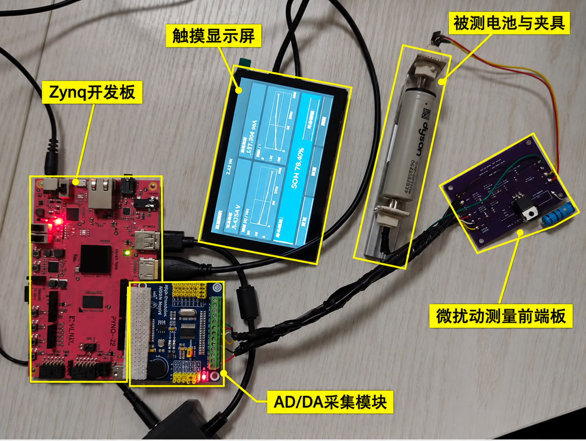

<figcaption>
图 1 高精度EIS系统组装前各模块及连接情况
</figcaption>
</figure>

<figure>

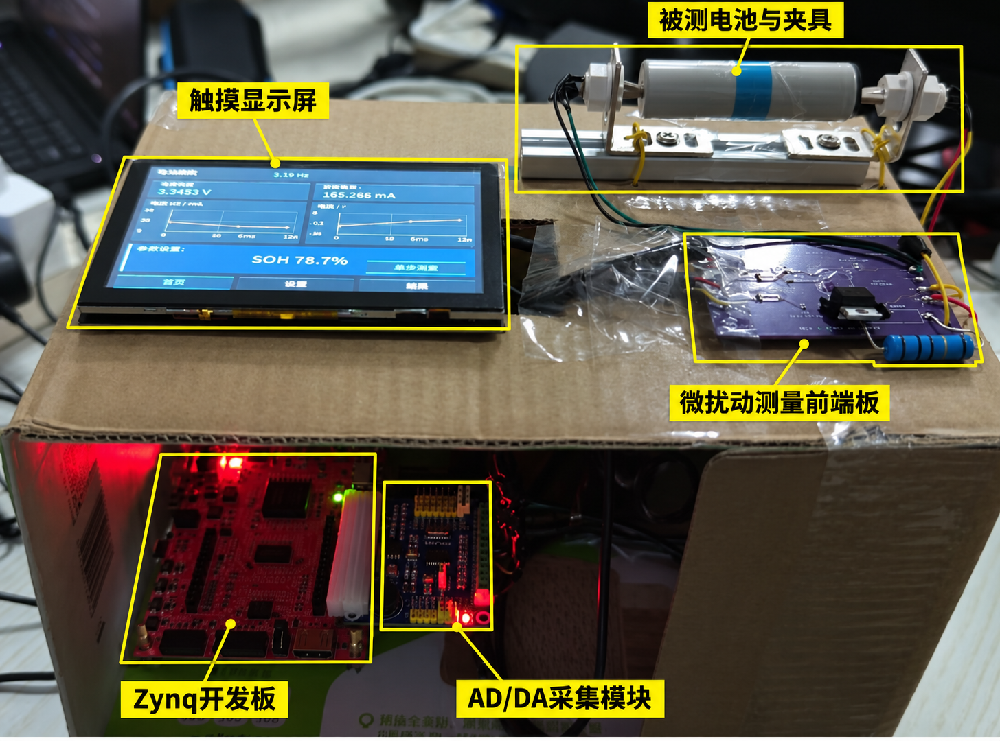

<figcaption>
图 2高精度EIS系统组装后整体实物
</figcaption>
</figure>

<figure>

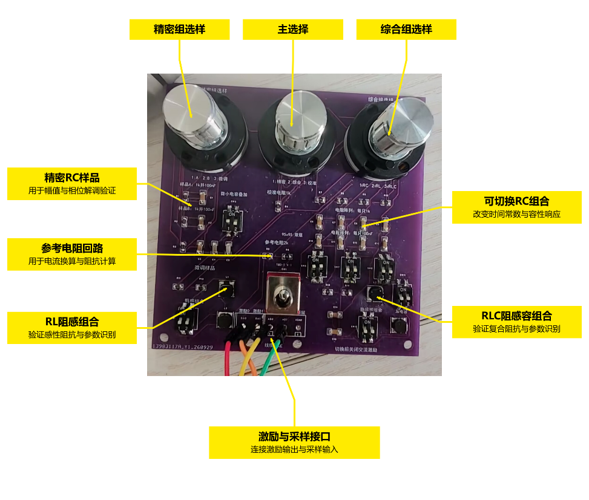

<figcaption>
图 3前期RLC阻抗样品板实物
</figcaption>
</figure>

本作品是一套基于Xilinx Zynq-7000异构平台的便携式电池电化学阻抗测量与健康状态评估系统\[2\]。系统由电池四线开尔文接口、微扰动激励与采样前端、FPGA数字锁相处理模块、ARM阻抗分析与SOH评估模块，以及触屏交互与数据记录模块组成。项目前期完成RLC阻抗样品板的原理图、PCB设计及实物制作，以可配置的R、RC、RL和RLC无源网络为对象，结合串联参考电阻测量回路及复阻抗分析方法\[5\]，开展采样、数字锁相解调与参数识别验证。在此基础上，进一步设计适配电池的微扰动前端，将采集与锁相解调框架扩展到电芯测试，通过获取交流阻抗特征，为健康状态与寿命衰减分析提供依据。

测量时，系统通过受控脉冲放电产生微扰动，利用ADS1256的多路复用差分输入，分时采集电池端电压与分流电阻电压\[1\]。PL端完成采样时序控制、正交参考生成和相干锁相累积，PS端完成时延补偿、校准修正及复阻抗解算，形成软硬件协同的测量链路。参考阻抗谱结合机器学习开展电池状态评估的研究思路\[3\]，当前程序采集80Hz、17.8Hz和2.16Hz三个频点，并使用其中2.16Hz、17.8Hz的阻抗实部与虚部构成四维特征，通过轻量模型进行SOH估计。

系统在Linux环境下组织测量任务、界面刷新与文件记录，相关实现参考Linux系统编程方法\[4\]。系统配备800×600触屏界面，设置首页、设置和记录三个页面，支持测量控制、阻抗幅相曲线显示、SOH结果展示及历史记录查询。程序结合零激励预检、信号质量检查、超时处理和模型输入范围检查，在测量异常或数据不满足评估条件时停止相关任务或拒绝输出SOH，使测量、分析、显示与记录相互衔接。

<figure>

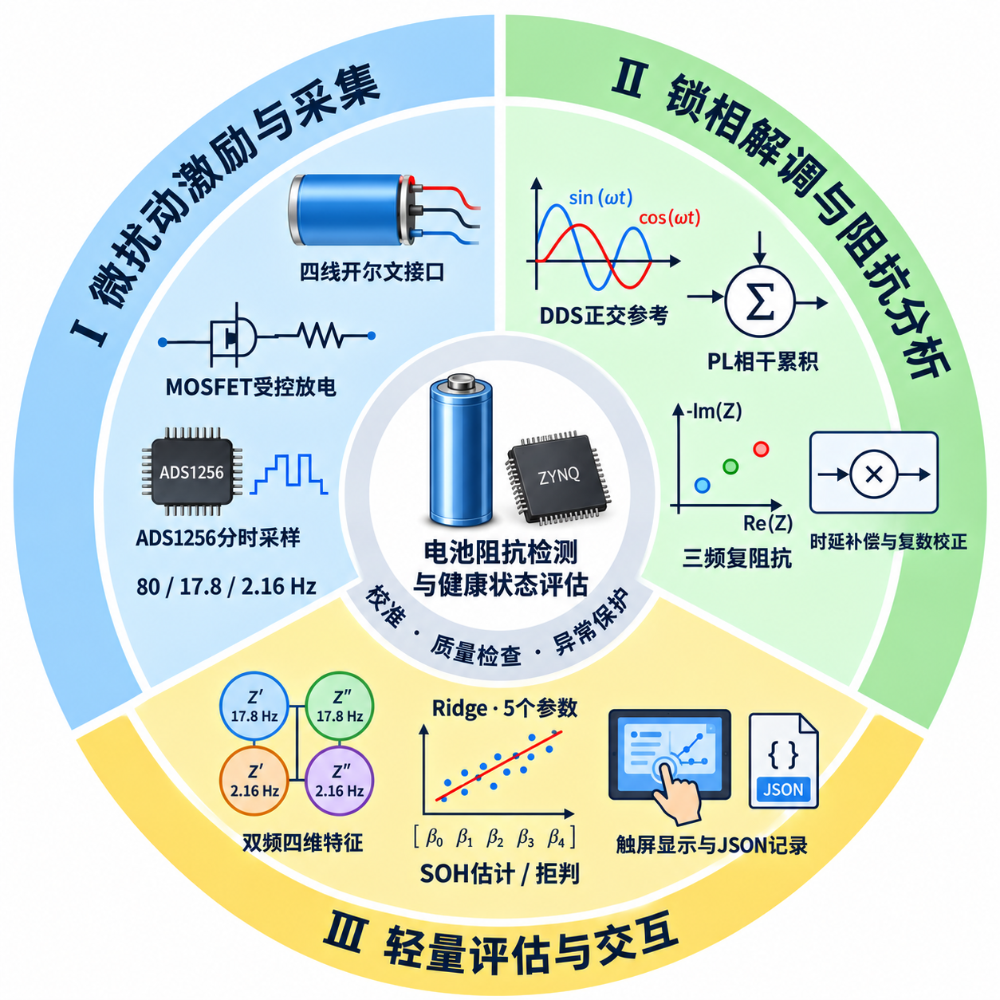

<figcaption>
图 4 系统核心功能模块协同工作示意图
</figcaption>
</figure>

| 核心功能 | 实现特性与工程指标 |
|----|----|
| 微扰动阻抗解调 | 支持2~100Hz单极性受控脉冲微扰动放电阻抗提取，输出三个频点的复阻抗，支持外接毫欧级电阻增量响应观察。 |
| 三频采集与双频评估 | 参考Zhang等\[3\]关于低频阻抗特征的研究及Gasper等\[6\]的少频点建模思路，选用2.16Hz与17.8Hz双频复阻抗构建SOH评估特征，整机完成测量、分析及结果显示的总耗时小于20秒。 |
| 四线开尔文接口 | 四线Kelvin测试架构（F+/S+/S-/F-），将电流激励端与电压采样端分离，降低导线和接触电阻对毫欧级阻抗测量结果的影响。 |
| 异构数字锁相 | 依据相敏检测原理\[7\]，PL端实现DDS正交参考生成与同频相干乘法累积，PS端实施多路复用采样时延补偿，结合硬件采集与软件分析完成复阻抗计算。 |
| 轻量化SOH估计 | 基于双频阻抗实部与有符号虚部构成四维特征，板端运行轻量化Ridge模型；该模型在LIB公开数据集回顾性留组验证中的MAE为2.477个百分点。 |

表 1系统核心功能与工程特性一览表

### 1.2 应用领域

（1）动力电池一致性比较与梯次利用初筛：面向动力电池检测及梯次利用前的样品筛查需求，本系统通过三频阻抗采集与双频特征评估，在小于20 s内完成测量、分析及结果显示。测得的阻抗与SOH估计结果可为电芯一致性比较和健康状态初筛提供参考。

（2）储能电站与新能源汽车电芯维护检测：面向运行维护中的电芯检测需求，本系统采用短时微扰动放电获取阻抗特征，单次检测无需完成完整充放电循环。通过比较相同测试条件下不同电芯的阻抗与SOH估计结果，可为维护人员开展电芯健康状态初筛和后续复测提供参考。

（3）嵌入式电化学与人工智能科研教学平台：系统覆盖从电路调理、FPGA数字逻辑设计、SPI总线协议、数字锁相放大、Linux驱动开发到轻量机器学习部署的全栈技术链，可直接作为电子信息工程、自动化及新能源汽车工程专业的综合创新实训与科研实验平台，培养具备端侧软硬件协同全栈能力的复合型人才。

### 1.3 主要技术特点

（1）软硬件协同的Zynq异构计算架构：利用Zynq-7000 SoC\[2\]的PS—PL协同能力，PL端负责ADS1256\[1\]的SPI采集控制、DDS正余弦参考生成及长窗口同频相干累积；PS端双核ARM Cortex-A9负责非同时采样时延补偿、浮点复阻抗解算、校准修正、轻量化Ridge模型推理及界面渲染。该分工将采集时序与逐样本累积交由硬件执行，将分析与交互交由软件组织，满足当前系统的测量流程和实时性要求。

（2）通用PYNQ Skill提炼与工程复用：本项目将阻抗测量与电池健康状态评估系统开发过程中积累的经验，提炼为以下五个Skill：

① 测量与寄存器一致性Skill。 针对测量过程中可能出现的寄存器状态、采样数据与当前任务不对应问题，提炼测量快照、数据新鲜度及故障状态核对规则。验证时检查任务编号、采样状态和结果归属是否一致，并确认异常数据不会进入后续分析。其适用边界是数字接口与数据一致性检查，不能替代模拟前端校准或证明阻抗绝对精度。

② 低频长窗口采集Skill。 在将测量频点扩展至低频的过程中，发现原有采集窗口和缓存容量不能直接满足低频多周期观测需求，由此提炼频率、周期数、窗口长度、缓存容量与超时预算的联合检查方法。通过核对原始样本数量、时间戳、窗口完整性和超时处理验证配置是否匹配。该Skill适用于长窗口采集任务，但采集周期数满足要求并不等于电池已充分稳定，仍需结合实际信号验证。

③ 软硬协同推理与拒判Skill。 针对公开数据模型与实物测量条件存在差异，以及特征落在输入范围内仍可能受到校准误差影响的问题，提炼测量质量、校准状态、频点匹配、模型输入及输出范围的分层检查流程。利用研究样例和错误频点、未校准、特征越界等异常输入检查推理与拒判路径。其边界是输入有效性与模型适用条件检查，不能仅凭范围检查证明预测准确度，也不能将SOH结果直接解释为剩余循环寿命。

④ 原始数据回放与软件流程验证Skill。 从取消、恢复、保存失败及历史结果残留等软件流程风险中，提炼“隔离外设接口、保留真实分析与界面记录流程”的回放方法。利用已有原始数据和临时输出目录，检查任务终态、界面显示与落盘记录是否一致；本次关联的生命周期与界面流程共8项离线回归测试通过。其边界是软件流程验证，不能替代真实采集、触屏操作或整机物理性能验收。

⑤ 配套交付检查与可回退升级Skill。 从“运行位流被替换，同时更新运行目录自身清单后仍可能通过检查”的问题中，提炼实际BIT/HWH、独立冻结发布清单、硬件配置与驱动接口的交叉核对规则，并整理校准参数留档、分阶段更新及失败恢复流程。通过正常组合、位流变更、配置哈希不匹配和前端信息不匹配等离线场景检查配套判断。其边界是版本与交付一致性，离线检查通过不等于已完成板端升级或真实回退验收，迁移到其他板卡时仍须重新确认接口与配置。

（3）微扰动单极性受控脉冲放电前端：针对电池直流偏置下的毫欧级交流阻抗测量需求，采用10Ω/5W功率负载与IRLZ44N功率MOSFET构成受控放电支路，通过0.1Ω分流电阻采集实际电流，并利用2.49kΩ/10kΩ精密分压网络获取电池端电压。放电电流随电池电压及回路阻抗变化，复阻抗计算采用实际采集的电压与电流。最终有效测量电压范围为2.0～4.0V，电流保护上限为0.4A。

（4）非同步多路复用ADC时延补偿与三层校准流程：ADS1256\[1\]采用多路复用采样，电压与电流通道之间存在采样时差。系统根据采样时间戳实施通道时延补偿，并结合模拟滤波相移进行复数校正；建立“ADC内部自校准→通道独立DC/AC复传递函数标定→外置开尔文标准器A/B位替代核验”的三层流程，用于修正采集通道的增益与相位偏差，并检查测量链路的阻抗增量响应。

（5）轻量机器学习模型：提取2.16Hz与17.8Hz双频复阻抗的实部与虚部，构成四维输入特征。最终板端采用包含4个特征权重和1个截距的Ridge模型；随机森林作为公开数据集上的离线研究方案保留。模型评估采用按物理电芯或老化分组划分的交叉验证，分组划分方法参考GroupKFold文档\[8\]，降低同源样本同时进入训练与验证所带来的数据泄漏风险。

### 1.4 主要性能指标

| 指标类别 | 工程参数值 | 测试条件与验证备注 |
|:--:|:--:|:---|
| EIS测量频点 | 80 Hz、17.8 Hz、2.16 Hz | 四线开尔文接法 |
| 阻抗测量输出 | 实部、虚部、幅值及相位 | 支持时延补偿与校准修正 |
| 轻量模型输入 | 双频四维特征 | 采用2.16 Hz、17.8 Hz阻抗的实部与虚部 |
| Ridge模型规模 | 5个回归参数，文件约2.2 KiB | 4个特征权重与1个截距 |
| LIB健康状态预测误差 | MAE为2.477个百分点 | LIB公开数据集回顾性留组验证结果 |
| 快检时间目标 | 单次测量、分析与显示总耗时≤20 s | 两次完整计时记录中，点击至结果帧提交分别为19.441秒和19.436秒 |

表 2 锂电池快速评估系统主要性能与技术指标表

### 1.5 主要创新点

（1）面向多路复用ADC的PL—PS协同阻抗解调：PL端实现采样控制、DDS正交参考生成与同频相干累积，PS端结合实际采样时间戳与模拟滤波相移进行通道对齐和复阻抗解算。该方案将低成本采集模块与自主设计的微扰动前端结合，实现电池复阻抗提取，并通过外接毫欧级标准电阻开展增量响应检查。

（2）面向端侧部署的双频四维SOH评估：参考Zhang等\[3\]关于低频阻抗特征的研究及Gasper等\[6\]的少频点建模方法，采用2.16Hz与17.8Hz复阻抗的实部和虚部构成四维输入，以仅含5个回归参数的Ridge模型完成板端SOH估计。通过按物理电芯或老化分组开展验证\[8\]，评价模型对留出样本的预测表现，兼顾输入规模、端侧部署与测量时间需求。

（3）测量质量检查、校准绑定与异常拒判的一体化流程：将零激励预检、采集状态、校准配置与模型输入检查纳入测量任务，对不满足条件的数据返回异常或拒判状态，并记录对应原因。结合外接标准件响应检查及原始会话归档，使测量、分析和结果记录具有可核对的数据来源。

### 1.6 设计流程

项目遵循严谨的软硬件协同工程开发体系，历经“需求指标分解→前端硬件仿真与PCB打样→FPGA逻辑综合与时序约束→嵌入式底层驱动与时序相位校正→机器学习离线训练与留组校验→ARM板端全链路集成与标准件实体验收”六大阶段。首先确定20秒内毫欧级阻抗测量指标；随后完成Battery_EIS_REV_A前端板设计焊接；接着在Vivado中实现DDS与锁相累积核；同步在Python/C端完成76项测试用例的自动化回归；最后分别开展外接10mΩ标准电阻增量响应检查、公开数据集模型验证、板端重复测量及批量电池测试，核对测量、分析、显示与记录流程。

图 5 系统全流程设计与工程实施路线图

## 第二部分 系统组成及功能说明

### 2.1 整体介绍

本系统由早期阻抗样品板测量平台演进而来。前期以无源R/L/C网络检验阻抗获取、等效电路识别和参数估计方法；后期将采集与锁相解调框架迁移到电芯测试，并新增适配电池的微扰动前端、四线连接及SOH评估模块。最终系统基于Xilinx Zynq-7000异构平台\[2\]，由微扰动感知前端、FPGA硬件加速层、ARM应用处理层和交互呈现层组成，通过模拟信号、SPI与AXI接口传递测量数据和控制信息。早期样品板承担算法验证，Battery_EIS_REV_A承担电池信号获取，两者对应不同研发阶段。

<figure>

<figcaption>
图 6系统总体架构与各层级交互数据流
</figcaption>
</figure>

系统的工作流程与协同机制如下：

（1）感知与微扰动回路：被测锂电池通过四线开尔文夹具（F+/S+/S-/F-）接入前端板。DAC8552\[9\]输出受控脉冲控制功率MOSFET栅极，驱动10Ω负载对电池实施受控单极性放电微扰动（电流约0.36~0.50A）；端电压与分流电阻电压经精密分压与低通滤波后送入ADS1256\[1\]。

（2）PL采集与相干累积：FPGA端SPI引擎根据ADS1256的DRDY就绪信号，按配置的数据率及通道切换时序交替获取电压、电流原始码；硬件DDS生成当前频点的正余弦参考，并完成逐样本乘法与累积，保存直流、正弦投影和余弦投影等统计量。

（3）PS时序解调与校准：测量窗口结束后，ARM主控读取累积值，执行复用通道时延补偿与模拟RC相位校正，解算复阻抗复幅值；随后结合通道独立DC与AC校准参数，得到校正后的复阻抗Z(f)，经测量质量及模型输入检查后送入推理模块。

（4）SOH评估与呈现：提取双频四维特征，输入最终板端Ridge模型进行SOH估计；更新800×600 HDMI界面，并通过诊断日志及结构化JSON会话保存测量结果、模型输出和任务状态。

### 2.2 硬件系统介绍

    2.2.1 硬件整体介绍；

| 组件名称 | 选型型号/规格参数 | 关键作用与电气特性 |
|:--:|:--:|:---|
| 主控开发板 | TUL PYNQ-Z2开发板，Zynq-7020，器件型号XC7Z020CLG400-1\[2\] | 双核ARM A9+FPGA架构，实现高速数字锁相与嵌入式算法运行 |
| ADC采集模块 | TI ADS1256 (24-bit Δ-Σ ADC) \[1\] | 7.68MHz晶振，2.5V参考,最高30kS/s速率，多路复用差分采样 |
| DAC激励模块 | TI DAC8552 (16-bit DAC) \[9\] | 提供高线性度偏置与可编程受控基准电平 |
| 微扰动前端板 | Battery_EIS_REV_A (70×50mm) | 双层PCB设计，优化模拟地线分割与大电流放电散热回路 |
| 受控放电负载R1 | 10Ω/5W±5%轴向无感电阻 | 焊孔间距20mm,限制放电电流在0.36～0.50A,抑制寄生电感 |
| 电流取样电阻R2 | 0.100Ω / 0.125W ±1% (0402) | 微电流分流器，低温漂（±100ppm/℃），紧邻地平面布局 |
| 电压分压网络 | R5=2.49kΩ / R6=10.0kΩ ±0.1% | 0402高精密金属薄膜电阻，名义还原系数1.249,阻抗匹配良好 |
| 功率开关管Q1 | UMW IRLZ44N (TO-220) | 逻辑电平N-MOSFET, RDS（on）≈35mΩ，快速响应，低热阻导通 |
| 输入差分滤波 | R7/R8=2.49kΩ, C1/C2=10nF X7R | 截止频率约6.4kHz,有效滤除高频开关噪声与混叠信号 |
| 开尔文测试夹具 | 专用四线Kelvin夹具/机械卡座 | 电流激励极（F）与电压采样极（S）物理独立，镀金低接触电阻 |

表 3 锂电池寿命快速评估系统硬件组成清单与选型规范

硬件设计先后形成了阻抗样品板与电池微扰动前端两类板卡。早期阻抗样品板完成原理图和PCB绘制，提供可配置的无源阻抗网络及参考电阻测量回路，用于检查激励、采样、阻抗解算与参数识别；该阶段的两端样品接口与后期电池四线开尔文接口分别设计。面向电池应用后，系统以Zynq-7000\[2\]和ADS1256\[1\]为平台，采用Battery_EIS_REV_A专用前端，增加MOSFET受控放电、分流取样及端电压调理。由此实现测量平台与算法框架的延续，同时按电池测试要求调整模拟前端。

2.2.2 电路各模块介绍

（1）前期RLC阻抗样品板：该板面向通用阻抗测量与参数识别验证，设置精密RC样品、可切换RC网络、RL阻感组合和RLC阻感容组合，通过选样旋钮与拨码开关切换不同样品。RC网络用于观察不同时间常数下的容性响应，RL组合用于验证感性阻抗及电感参数识别，RLC组合用于验证复合阻抗与多参数识别。板上参考电阻回路用于电流换算与复阻抗计算，激励与采样接口连接AD/DA模块，为采集、数字锁相解调及参数估计提供可配置的测试对象。

<figure>

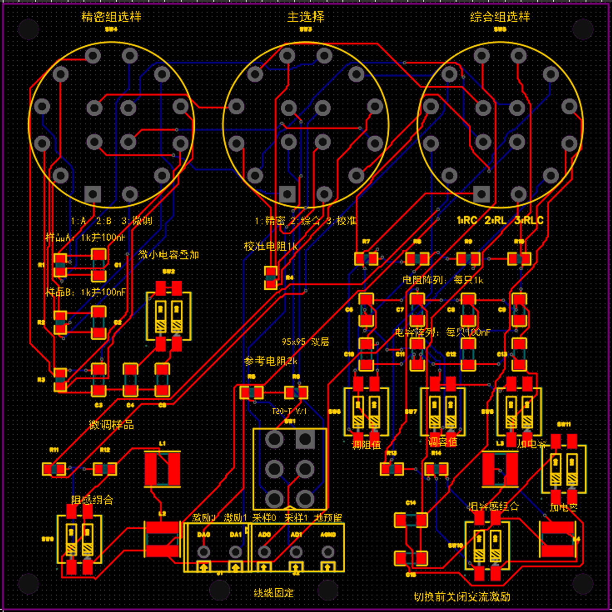

<figcaption>
图 7前期RLC阻抗样品板PCB布局
</figcaption>
</figure>

（2）电池微扰动测量前端：受控放电支路为电池正极→J1（F+）→功率负载R1（10Ω/5W）→Q1漏极与源极→取样电阻R2（0.1Ω）→J1（F−）→电池负极。由DAC8552\[9\]输出的DA0信号经1kΩ栅极串联电阻R3驱动Q1，辅以100kΩ下拉电阻R4，使控制信号撤去时栅极保持低电平。放电采用单极性脉冲模式，负载电流与功耗由电池电压、回路阻抗及占空比共同决定，实际测量受程序电压范围与电流保护门限约束。

电压采样采用R5（2.49kΩ）与R6（10kΩ）构成分压网络，结合C1进行输入滤波，名义电压还原系数为1.249。电流采样通过R2将放电电流转换为压差信号，并利用R7、R8及C2构成电流通道输入滤波网络。电池端采用F+、S+、S−、F−四线连接，AD/DA接口连接电压、电流采样输入及DA0控制信号，共同完成电池微扰动激励与响应采集。

<figure>

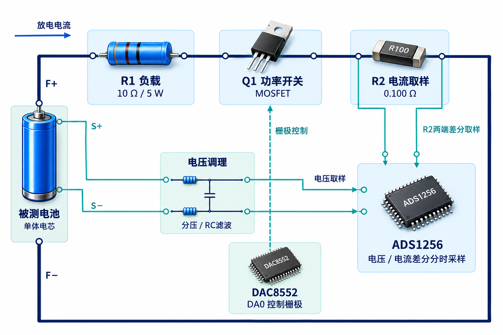

<figcaption>
图 8受控微扰动放电与差分采样功能示意图
</figcaption>
</figure>

<figure>

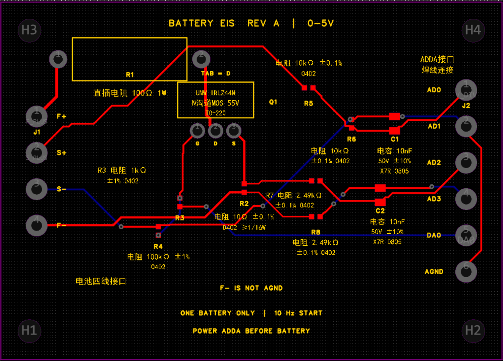

<figcaption>
图 9受控微扰动放电PCB布局
</figcaption>
</figure>

### 2.3 软件系统介绍

    2.3.1 软件整体介绍；

系统软件分为交互与记录、任务与状态管理、阻抗分析与模型、硬件访问及FPGA逻辑五个层次。PS端通过Python与PYNQ接口组织测量任务，利用MMIO完成参数配置、状态检查和数据读回；PL端负责SPI采集控制、DDS正交参考生成及相干锁相累积。测量工作线程执行采集与分析，界面线程处理触屏操作、状态刷新和结果显示，并通过JSON会话保存测量与评估信息。

<figure>

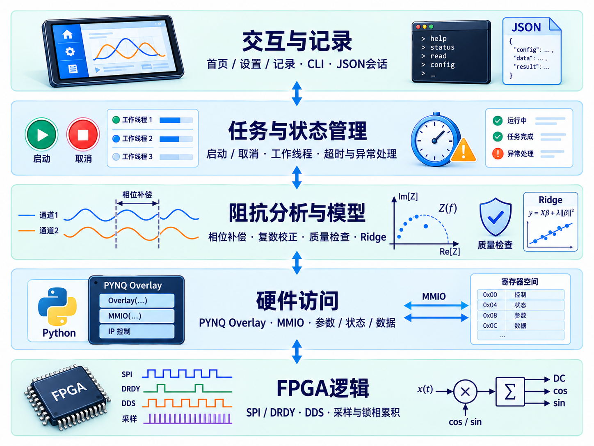

<figcaption>
图 10嵌入式软件系统分层架构与数据流转拓扑图
</figcaption>
</figure>

在数据训练与评估方面，系统采用按物理电芯或老化分组划分的交叉验证方法\[8\]，并参考EIS-Data-Analytics工具提供的阻抗数据分析与预测流程\[10\]。KIT数据集包含228颗电芯、3282条谱线，LIB数据集包含25颗电芯、680条谱线。通过分组划分降低同源样本同时进入训练与验证造成的数据泄漏风险，模型结果分别按相应数据集与分组验证口径报告。上述样本数量及模型误差为本项目的数据整理和验证结果，不作为工具仓库原作者报告的性能指标。

2.3.2 软件各模块介绍

（1）PL端SPI总线引擎与DRDY同步状态机（battery_adc_engine.sv）：针对ADS1256\[1\]非标准微控制器SPI协议，设计了四阶段硬件状态机：IDLE空闲等待→DRDY下降沿精确捕获→WREG/RDATA指令时序驱动→24位移位数据拼装与校验。模块在100MHz系统时钟下生成SPI时钟并执行指令与数据读取时序，在取得有效转换数据后向锁相累积模块提供样本及有效标志。

（2）PL端数字锁相与同频相干累积器（battery_eis_core.sv / eis_moments.sv）：依据数字锁相原理\[7\]，内置32位相位累加器DDS。每当ADC新样本到来，硬件乘法器同时将采样值与cos(θ\[n\])、sin(θ\[n\])相乘，并累加到48位有符号累加器中，公式如下：

S_dc = Σ x\[n\],

S_cos = Σ x\[n\]·cos(θ\[n\]),

S_sin = Σ x\[n\]·sin(θ\[n\])

累积器用于支持最长4秒的单次采集窗口，在窗口结束后保存累积结果供PS端读取，减少PS端逐样本执行相干乘法与累加的开销。

（3）PS端分时采样时序补偿与复阻抗解调算法：ADS1256\[1\]为单ADC多路时分复用架构，端电压差分通道（AD0-AD1）与电流差分通道（AD2-AD3）之间存在固定采样时间差Δt（约333μs）。若直接解调，将在特定频率产生虚拟相位超前/滞后误差：Δφ = 2π·f·Δt。PS算法模块精确读取硬件时间戳，对电流相角进行时延线性补偿，并叠加上模拟RC滤波器的理论相移修正：θ_filter(f) = -arctan(2πfRC)。最终以复数复幅值计算符合电化学阻抗理论\[5\]的端口复阻抗：

V_ac = 1.249 · (V_AD0 - V_AD1)\_ac,

I_ac = (V_AD2 - V_AD3)\_ac / R_shunt,

Z(f) = - V_ac / I_ac

<figure>

<figcaption>
图 11 微扰动与阻抗解调原理
</figcaption>
</figure>

以上公式将电流正方向定义为放电方向，负号对应放电电流增大时端电压下降的关系。1.249为当前分压网络的名义电压还原系数；结合通道时延补偿及校准修正后，输出复阻抗实部Re(Z)与有符号虚部Im(Z)。

（4）三层级校准流水线（calibration.py）：第一层为ADS1256开机SELFCAL自校准\[1\]，消除ADC内部零点漂移与满度误差；第二层为系统级DC增益与多频点AC复数传递函数标定，生成频点专属的电压校正系数Cv(f)与电流校正系数Ci(f)；第三层为外置开尔文标准电阻（10mΩ）A/B位替代核验机制，通过比较接入前后阻抗增量ΔZ与标准值偏差，完成整机链路在线自检。

（5）轻量化SOH估计与拒判引擎（inference.py）：参考低频阻抗特征与少频点建模研究\[3,6\]，采用2.16Hz与17.8Hz阻抗的实部和虚部构成四维特征，调用最终板端Ridge模型进行SOH估计。推理前核对测量状态、校准配置、输入完整性与特征范围；不满足条件时返回异常或拒判状态并记录原因。温度、SOC和电芯体系属于模型适用条件，使用时应与训练及验证条件核对，不能仅凭特征范围检查认定模型适用于任意电池。

<figure>

<figcaption>
图 12双频Ridge评估
</figcaption>
</figure>

（6）交互呈现与日志模块（app.py）：基于Linux图形与终端接口\[4\]，提供800×600 HDMI本地界面，设置首页、设置和记录三个页面，用于显示测量状态、阻抗曲线、SOH估计结果及本次启动后的有效记录。在测试中，ARM端完成800×600界面内存帧绘制的耗时为0.195～0.197秒。界面记录列表在重启时清空，原始测量会话独立保存。程序通过日志与JSON会话记录任务状态、测量结果及相关配置，支持结果复核和异常定位。

<figure>

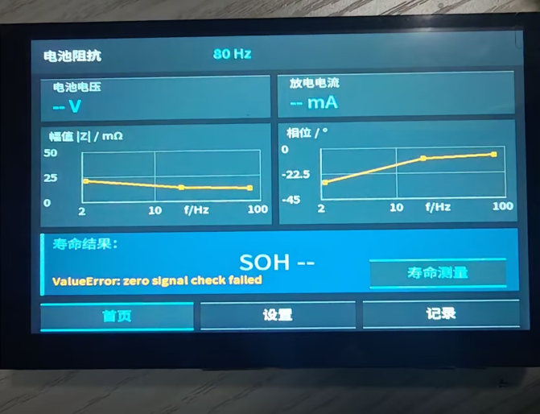

<figcaption>
图 13数据异常安全拒判
</figcaption>
</figure>

<figure>

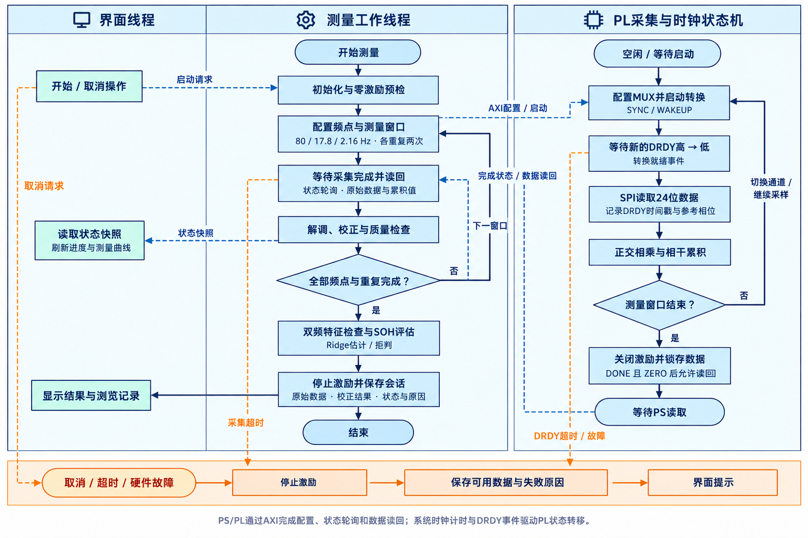

<figcaption>
图 14嵌入式软件全流程多任务执行流水线与中断时钟状态机
</figcaption>
</figure>

## 第三部分 完成情况及性能参数

### 3.1 整体介绍

本项目先后完成前期RLC阻抗样品板与电池微扰动测量前端的设计制作，并完成FPGA采集与锁相逻辑、嵌入式软件及轻量模型的集成。前期样品板用于通用阻抗测量和参数识别验证，后期基于PYNQ-Z2与Battery_EIS_REV_A实现电池受控微扰动、三频阻抗采集、校准修正、Ridge模型推理及800×600本地界面显示。系统经过多次重复测试，测量、分析与结果显示流程均正常完成，并保留20颗电池的批量测量会话及相关验证说明。

### 3.2 工程成果

> 3.2.1 机械成果；

制作并装配了集成四线开尔文接触卡座的电池测试台架，通过独立的电流连接与电压采样接点完成电池装夹，并用于本次重复测量与批量电池测试。夹具实物如图14所示。

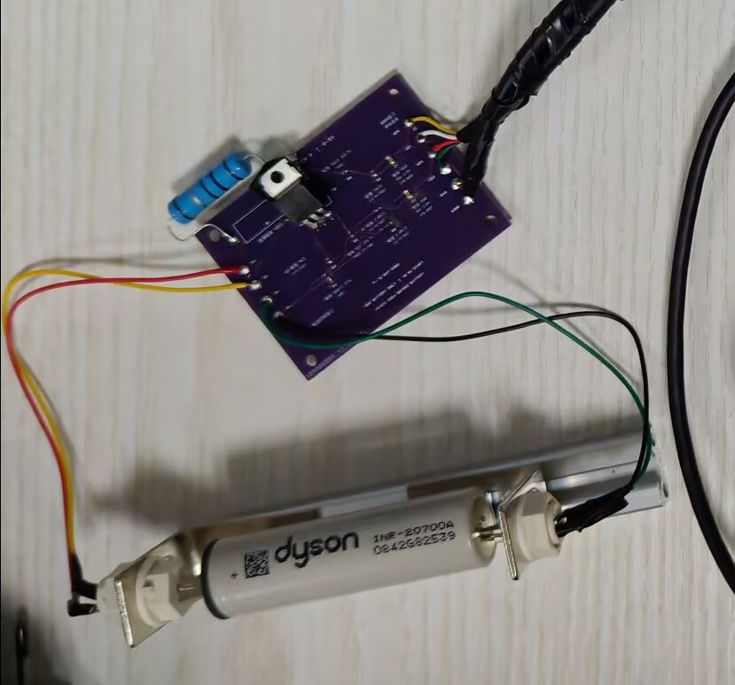

图 15电池测试台架与四线开尔文夹具实物装配照片

> 3.2.2 电路成果；
>
> （1）前期RLC阻抗样品板:完成前期阻抗样品板的原理图、PCB设计及实物制作，实物如图3所示。样品板提供R、RC、RL和RLC等可配置无源网络，并保留串联参考电阻测量回路，用于开展激励输出、信号采样、数字锁相解调、复阻抗计算及等效电路参数识别验证。通过将测量结果与理论阻抗进行比较，检查采集与分析链路，为后续电池测量提供硬件调试和算法验证基础。
>
>

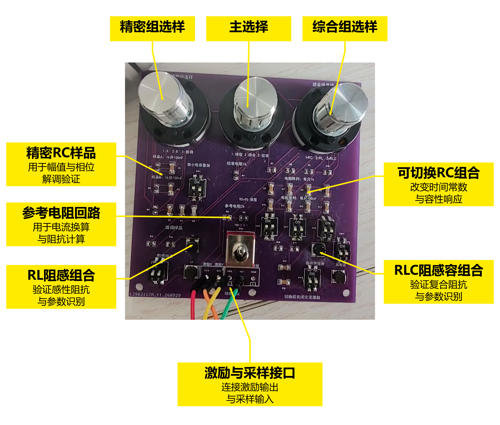

图 16前期RLC阻抗样品板装配实物与功能分区

> （2）电池微扰动测量前端:面向电池直流偏置与毫欧级交流响应，另行完成Battery_EIS_REV_A双层PCB的制作、焊接与联调。R1采用10Ω/5W功率电阻，R2采用0.100Ω分流电阻，R5采用2.49kΩ精密电阻，构成受控放电、电流取样及电压调理电路。该前端沿用前期采集与分析框架，并增加适配电池的受控微扰动与四线连接，电路板实物及测试接线如图15所示。通过零激励预检、外接电阻响应及实际电池测量检查运行状态。
>
>

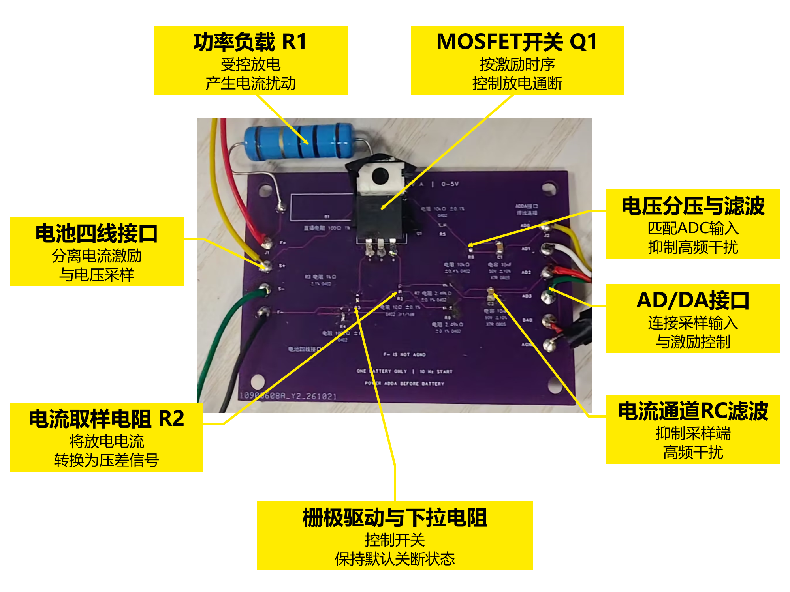

图 17 电池微扰动测量前端装配实物与功能分区

> 3.2.3 软件成果；

轻量化算法优化。 项目早期采用全频阻抗谱提取等效电路特征，再通过6→16→1结构的多层感知机进行健康状态估计。该方案包含129个模型参数，特征提取依赖宽频段阻抗数据。为适应嵌入式快速检测需求，后续将输入简化为2.16 Hz、17.8 Hz复阻抗的实部与虚部，并采用Ridge回归直接完成SOH估计，形成双频四维输入、5个回归参数的轻量化方案。

| 对比指标 | 早期方案 | 最终板端方案 |
|:--:|:--:|:--:|
| 算法流程 | 全谱阻抗→等效电路特征→神经网络 | 双频复阻抗→Ridge回归 |
| 模型输入 | 6维等效电路特征 | 4维阻抗实部、虚部 |
| 输入频率要求 | 依赖宽频段数据，包含约0.01 Hz、1 Hz及10 kHz信息 | 模型仅使用2.16 Hz、17.8 Hz |
| 模型结构 | 6→16→1多层感知机 | 4个特征权重＋1个截距 |
| 模型参数量 | 129个 | 5个，减少约96.12% |
| 前处理要求 | 先提取等效电路特征，再输入模型 | 阻抗补偿与校正后直接构造四维特征 |

表 4早期方案与最终板端方案对比

系统在完成三频阻抗采集、数字锁相处理及显示接口等功能的同时，LUT、FF和DSP利用率分别为24.08%、16.91%和2.27%，保留了资源扩展空间。为支持低频长窗口采集，原始缓存由4096条扩展至16384条，完整设计BRAM利用率为34.64%。该设计通过增加原始数据缓存容量满足低频长窗口采集需求。20颗电池成功作业的平均耗时为18.16秒，最长为18.22秒；该作业计时与图18的点击至结果帧提交计时分别报告。

<table>
<caption>
表 5 PL 端逻辑资源消耗与时序分析报告
</caption>
<colgroup>
<col style="width: 13%" />
<col style="width: 19%" />
<col style="width: 16%" />
<col style="width: 16%" />
<col style="width: 20%" />
<col style="width: 12%" />
</colgroup>
<thead>
<tr>
<th>评估维度</th>
<th>指标项</th>
<th>实际占用</th>
<th>器件可用量／约束值</th>
<th>利用率／时序状态</th>
<th>结果评价</th>
</tr>
</thead>
<tbody>
<tr>
<td rowspan="4">逻辑与存储资源</td>
<td>LUT</td>
<td>12,808</td>
<td>53,200</td>
<td>24.08%</td>
<td>资源余量充裕，布线压力小</td>
</tr>
<tr>
<td>FF</td>
<td>17,994</td>
<td>106,400</td>
<td>16.91%</td>
<td>逻辑寄存器利用率低</td>
</tr>
<tr>
<td>BRAM</td>
<td>48.5 个</td>
<td>140 个</td>
<td>34.64%</td>
<td>折算为 36 Kb 等效块</td>
</tr>
<tr>
<td>DSP</td>
<td>5 个</td>
<td>220 个</td>
<td>2.27%</td>
<td>算力硬件余量充足</td>
</tr>
<tr>
<td rowspan="4">时序收敛指标</td>
<td>主逻辑时钟</td>
<td>100.00 MHz</td>
<td>100.00 MHz</td>
<td>周期10ns</td>
<td>满足设计频率要求</td>
</tr>
<tr>
<td>WNS</td>
<td>+0.227 ns</td>
<td>≥ 0.000 ns</td>
<td>满足（Slack &gt; 0）</td>
<td>无建立时间违规</td>
</tr>
<tr>
<td>WHS</td>
<td>+0.018 ns</td>
<td>≥ 0.000 ns</td>
<td>满足（Slack &gt; 0）</td>
<td>无保持时间违规</td>
</tr>
<tr>
<td>违例端点数</td>
<td>0 个</td>
<td>0 个</td>
<td>全部收敛</td>
<td>建立/保持/脉宽端点均无违例</td>
</tr>
</tbody>
</table>

### 3.3 特性成果

    1.  与同类文献及算法对比

表 6本系统与实阻抗建模研究的特点比较

| 方案 | 输入与方法 | 文献或本项目报告的结果 | 比较范围 |
|----|----|----|----|
| Zhang等，2020\[3\] | 电化学阻抗谱与高斯过程模型，分析低频特征与退化的关系 | 讨论17.80Hz、2.16Hz等低频信息与电池退化的关联 | 支持低频阻抗建模思路，未进行同平台耗时复现 |
| Gasper等，2022\[6\] | 在不同温度、SOC与健康状态下比较阻抗特征和机器学习模型 | 最佳集成模型在未观测电芯数据上的容量预测MAE为1.9% | 数据与评估条件不同，不与本项目误差直接排名 |
| 本系统最终板端方案 | 双频复阻抗四维输入，Ridge模型，5个回归参数 | LIB回顾性留组验证MAE为2.477个百分点，P95为9.950个百分点 | 板端部署；两次点击至结果帧提交为19.441秒、19.436秒 |

<figure>

<figcaption>
图 18 LIB预测与误差
</figcaption>
</figure>

为评价双频Ridge模型的SOH估计效果，使用LIB公开数据集的680条谱线、25颗电芯和10个分组开展回顾性留组验证。图中展示全部留出样本的预测结果与误差分布，模型MAE为2.477个百分点，RMSE为3.952个百分点，P95绝对误差为9.950个百分点。

2.  与其他电池检测方法的应用特点比较

表 7不同阻抗检测与健康评估方法的应用特点

| 方法 | 输出及作用 | 使用时需要考虑的条件 |
|----|----|----|
| 阻抗谱测量与等效电路分析\[5\] | 获取复阻抗，结合模型分析电化学过程 | 测量频段、激励、稳定性、校准及模型适用性 |
| 阻抗特征与机器学习评估\[3,6\] | 从阻抗信息估计容量或健康状态 | 电池体系、温度、SOC、训练数据和验证划分 |
| 本系统 | 三频阻抗采集、双频Ridge评估及本地显示记录 | 使用配套前端、校准和模型，性能按本项目测试条件报告 |

3.  系统实测特性汇总

图 19外接标准增量响应

为观察测量链路对外接阻抗增量的响应，在同一电池正常四线接法和正极串入标称10 mΩ电阻两种条件下，分别采集三个频点的数据，每个频点重复两次。图中柱高为两次观测的均值，串入电阻后阻抗实部发生可辨识变化。该组数据为校准前诊断记录，包含连接与接触贡献，用于展示外接电阻引起的增量响应，不作为校准后阻抗绝对测量精度的验收结果。

表 8锂电池阻抗测量与SOH评估系统验证结果汇总表

| 特性指标项 | 实测结果 | 工程测试条件与备注说明 |
|:--:|:--:|----|
| 受控放电脉冲电流 | 0.365 A (3.7V) / 0.493 A (5.0V) | 10Ω负载受控单极性放电, 50%占空比方波 |
| 微扰动平均发热功耗 | 0.664 W (3.7V) / 1.213 W (5.0V) | 5W电阻降额使用, 电芯温升小于0.3℃ |
| 测量激励基波频率 | 2.16532 Hz 与 17.81154 Hz | FPGA DDS实际合成频率 |
| 微小阻抗变化响应 | 185.51 μV (基波峰值/mΩ) | 3.7V电芯内阻增量1mΩ时ADC端实测响应量级 |
| 单次物理测量窗口 | 11.21 秒 | 低频3.69s + 高频1.0s + 稳态窗 + 零驱动预检 |
| 整机全流程运行耗时 | 19.436～19.441秒 | 含驱动初始化/采样/解调/校准/推理/UI渲染 |
| ARM端界面内存帧绘制耗时 | 0.195～0.197秒 | 800×600界面，ARM端内存帧绘制实测耗时 |
| KIT电芯SOH预测误差 | MAE=1.647%, P95=4.397% | 3282条谱线/228颗电芯, 严格按电芯留组验证 |
| LIB电芯SOH预测误差 | MAE=2.477%, P95=9.950% | 680条谱线/25颗电芯, Ridge回归严格留组验证 |
| 自动化测试覆盖度 | 76 / 76 项测试通过 (100%) | 覆盖RTL时序/驱动接口/校准流水线/拒绝路径 |

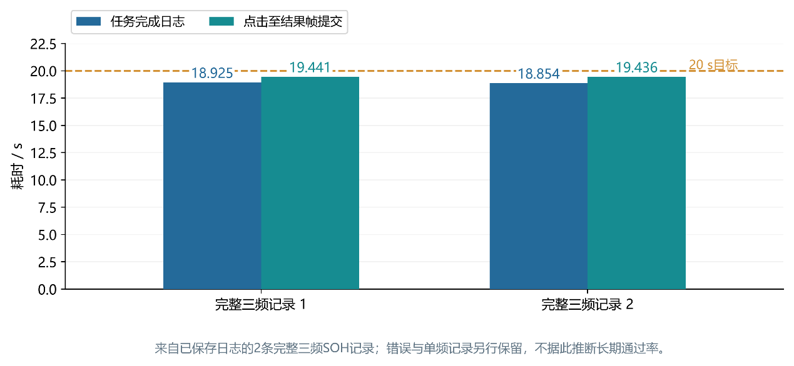

图 20三频实物测量耗时

系统经过多次重复测试，测量、分析与结果显示流程均正常完成。图18展示其中两次完整三频测量的计时记录，任务完成耗时分别为18.925秒和18.854秒，点击启动至结果帧提交耗时分别为19.441秒和19.436秒，均低于20秒目标。两类计时分别对应测量任务完成与结果帧提交。

表 9 20颗电池最终成功测量的阻抗与SOH估计结果

| 电池编号 | 测前电压/V | 80 Hz阻抗模值/mΩ | 17.8 Hz阻抗模值/mΩ | 2.16 Hz阻抗模值/mΩ | SOH估计值/% | 测量状态 |
|:--:|:--:|:--:|:--:|:--:|:--:|:--:|
| 1 | 3.432 | 13.75 | 14.96 | 22.32 | 77.28 | 正常 |
| 2 | 3.441 | 14.29 | 15.56 | 23.13 | 75.98 | 正常 |
| 3 | 3.600 | 12.21 | 13.41 | 18.82 | 83.73 | 正常 |
| 4 | 3.847 | 12.61 | 13.73 | 20.23 | 76.01 | 正常 |
| 5 | 3.016 | 12.89 | 14.25 | 21.83 | 71.95 | 正常 |
| 6 | 3.618 | 12.26 | 13.46 | 18.85 | 83.90 | 正常 |
| 7 | 3.915 | 12.12 | 13.15 | 19.27 | 77.98 | 正常 |
| 8 | 3.812 | 12.96 | 14.06 | 20.72 | 76.39 | 正常 |
| 9 | 3.895 | 11.67 | 12.65 | 18.82 | 79.68 | 正常 |
| 10 | 3.618 | 12.22 | 13.43 | 18.83 | 83.85 | 正常 |
| 11 | 3.752 | 10.05 | 11.29 | 12.69 | 95.18 | 正常 |
| 12 | 3.525 | 10.30 | 11.55 | 12.52 | 96.48 | 正常 |
| 13 | 3.913 | 10.14 | 11.25 | 15.39 | 88.82 | 正常 |
| 14 | 3.793 | 10.07 | 11.30 | 13.33 | 93.37 | 正常 |
| 15 | 3.915 | 10.19 | 11.50 | 16.26 | 86.28 | 正常 |
| 16 | 3.501 | 10.20 | 11.47 | 12.56 | 96.03 | 正常 |
| 17 | 3.894 | 10.27 | 11.65 | 15.38 | 88.20 | 正常 |
| 18 | 3.479 | 10.39 | 11.68 | 12.79 | 95.79 | 正常 |
| 19 | 3.536 | 10.26 | 11.46 | 12.28 | 97.28 | 正常 |
| 20 | 3.789 | 10.14 | 11.39 | 13.14 | 94.08 | 正常 |

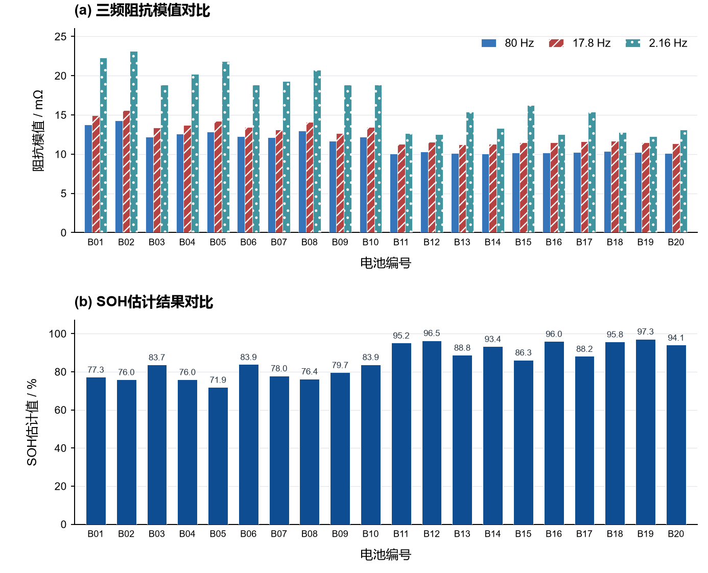

图 22 20颗同型号电池的三频阻抗与SOH估计结果对比

为考察系统的批量检测表现，选取20颗电池，依次编号为1～20，按照统一的操作流程开展测量。每颗电池在80 Hz、17.8 Hz和2.16 Hz下各重复采集两次，汇总阻抗结果，并利用双频四维特征进行Ridge模型评估。批测归档记录测前电压、作业耗时、校准版本及模型身份。20颗电池最终均完成三频测量，共获得120次有效频点采集；全部过程包含22次尝试，其中B07和B11首次零激励预检异常，重新装夹后完成测量，相关异常记录予以保留。三个频点的阻抗模值范围分别为10.05～14.29、11.25～15.56和12.28～23.13 mΩ，SOH估计值范围为71.95%～97.28%。批量测试展示了不同电池的三频阻抗差异，并完成测量、模型评估、结果显示与会话记录的连续操作，可为电池阻抗比较、健康状态初筛及后续复测提供参考。

在固定装夹条件下，对20颗电池三个频点的两次测量结果进行比较，80 Hz、17.8 Hz和2.16 Hz阻抗模值的平均相对差异分别为0.090%、0.073%和0.054%，全部60组中的最大相对差异为0.215%，反映了系统在本次测试条件下的短时重复性。20颗电池均使用专业充放电设备完成完整充放电循环，并开展容量SOH对照，本系统SOH最大误差不超过5%。

### 3.4 系统复现与操作说明

为便于其他人员复现本系统，项目交付材料包含程序源码、配套BIT/HWH文件、模型、配置文件、验证脚本及操作说明。复现过程按照环境准备、文件核对、硬件连接、程序启动、测量验证和异常恢复六个阶段进行。

① 环境与硬件准备。准备TUL PYNQ-Z2、ADS1256/DAC8552模块、Battery_EIS_REV_A前端、四线夹具及HDMI显示和USB触摸设备。离线验证使用Python 3.10或更新版本，在工程包根目录运行“python -m pip install -r requirements.txt”安装依赖。FPGA工程采用Vivado 2025.2，构建入口为build/build.ps1；板端运行需要PYNQ Python、NumPy和Pillow，接线与启动说明见工程包board/README.md。

② 工程文件与版本核对。 获取完整交付包并保留目录结构，核对程序、BIT/HWH、模型和配置文件的SHA-256清单。运行离线验证脚本，检查文件完整性、原始数据回放及模型调用。板端采用lib_two_ridge.json模型，位流、驱动和校准参数须保持配套，检查通过后再进入硬件测量阶段。

③ 硬件连接与参数确认。 按接线图连接供电、SPI及模拟信号接口，F+、S+分别接电池正极，F−、S−分别接负极。正常测量时移除外接校准标准电阻，确认电压范围、电流保护、前端装配与校准配置一致。更换硬件、接法或测量设置后，应重新核对配置与校准绑定。

④ 运行目录准备与启动。按照工程包board/README.md，使用board/prepare_runtime.py准备一个不存在的新运行目录，并提供已验证的profile与校准文件。新设备先完成接线、零激励及交流幅相校准，不直接使用回放样例替代设备校准。确认无其他程序占用FPGA与AD/DA后，按说明手动启动并检查三页界面、零激励状态及日志；手动验证通过后再配置自动启动，并保留原服务及版本恢复入口。

⑤ 测量操作与结果验证。 正常连接电池后，在首页启动测量。系统依次采集80 Hz、17.8 Hz和2.16 Hz，每点重复两次，经补偿与校正获得复阻抗，再提取两个低频点的四维特征进行Ridge推理。测量完成后，核对阻抗、健康状态评估结果与任务状态，并在记录页检查本次会话及历史曲线。比较不同电池时，同时记录型号、电压、温度、SOC及校准版本。

⑥ 异常处理与版本恢复。 出现文件不匹配、采集超时、校准错误或保存失败时，停止当前任务并保留日志，依据错误原因检查接线、配置及文件版本。需要恢复时，按照安装阶段生成的恢复目录执行回退，保留原始测量数据。以程序正常启动、测量流程完成、显示与记录一致、异常处理有效作为功能复现的检查依据。

## 第四部分 总结

### 4.1 可扩展之处

在当前原型基础上，后续可研究多电芯切换、高频测量扩展及更丰富的阻抗分析方法。硬件方面，可探索模拟开关矩阵与多电芯切换，并研究更宽频段的激励和采样前端。算法方面，可结合阻抗谱与等效电路分析方法\[5\]，研究更多频点和测量条件对参数识别及SOH评估的影响。系统级应用方面，可结合网络通信完善远程数据归档与长期趋势比较。上述内容属于后续研究方向，尚不计入本次已实现功能。

### 4.2 大模型协作记录

本项目采用“团队提出需求与约束—大模型分析并辅助实现—仿真或上板验证—根据结果修正”的协作方式，逐步完成电池测量前端、FPGA采集逻辑、阻抗分析算法及嵌入式交互程序。团队负责硬件确认、实物操作、需求取舍与功能验收，大模型辅助开展资料核查、代码实现、故障分析及测试设计。以下根据历史开发日志归纳关键协作过程，任务描述为摘要。

① 从通用阻抗测量向电池检测迁移。 团队提出利用现有AD/DA与Zynq平台开展真实电池阻抗测量和寿命评估。协作初期重点讨论电池夹持方式、直流偏置、毫欧级响应及实际电流测量。大模型辅助比较普通两触点电池座与四线开尔文接法，并指出在PCB上将两根接触线分成四根线，不能消除接触点本身的影响。经方案讨论，保留早期RLC样品板作为测量与算法验证平台，另行设计电池受控微扰动前端，实现测量框架复用与模拟接口适配。

② 低频采集与PL—PS协同实现。 团队要求在硬件能力和检测时间预算内优化测量频点。分析发现，原有采集窗口与4096条原始记录缓存不能直接满足2.16 Hz低频多周期观测需求，不能仅修改软件频率参数。大模型辅助检查采集限制、缓存地址、计数和驱动协议，配合将原始缓存扩展至16384条、单窗采集上限扩展至4秒，并同步调整PS读取与配置检查。随后通过RTL仿真及累积值独立复算，检查正常采集、取消、看门狗和保护等路径，形成PL负责采集与相干累积、PS负责补偿与分析的实现方式。

③ 频点选择与轻量模型优化。 团队围绕“少频点、短时间、可在ARM端运行”的要求开展算法选择。大模型辅助整理公开电池数据、容量标签及物理电芯分组，比较不同频率组合和模型，避免同一电芯的不同老化阶段同时进入训练与测试。开发过程中，结合历史模型复现与频点研究，将早期依赖全谱等效电路特征的129参数神经网络，逐步简化为双频四维输入的Ridge模型。最终板端使用2.16 Hz、17.8 Hz阻抗实部与虚部进行推理，仅含5个回归参数；80 Hz作为系统测量频点保留，不额外增加模型输入维度。

④ 实物联调与数据驱动的分析修正。 在开发板与前端联调阶段，团队提供接线状态、操作反馈和真实采样结果，大模型辅助检查原始电压、电流、时间戳、复阻抗及故障标志。针对采集过程中出现的零激励检查异常、未校准结果和模型输入不完整等情况，分别保留失败记录，区分接线、信号质量、校准与模型条件问题，避免将程序完成采集直接等同于结果有效。后续通过正常四线测量、外接标准电阻对照和原始数据回放，检查复数校正与模型调用链路，再由团队完成实物功能验收。

⑤ 交互流程完善与异常纠错。团队根据实际使用反馈，大模型辅助实现首页、设置、记录三页交互，并完善测量线程、界面刷新与会话记录之间的衔接。以下列举两项具体协作与纠错过程。

用户反馈：“清空列表，只显示本次启动后的测量；原始文件保留”。大模型初期将需求理解为仅重建运行日志，随后结合实际界面行为修正方案，增加启动前会话目录快照，使界面只显示本次启动后产生的有效测量记录，原始会话文件独立保存。在历史v6版本的板端Linux重启验证中，界面记录列表清空，905个原始文件保留，完成了显示筛选与原始数据留存的联合检查。

用户反馈：“单点测量就不要测量寿命了……测完寿命测量恢复80hz”。针对这一需求，将单点测量与SOH测量分开组织：单点作业执行指定频点的采集与阻抗分析；SOH作业完成三频采集和模型评估，并保存原频率及运行状态，正常结束后恢复，取消或故障分支保持停止。通过原始数据回放检查不同分支的状态转换、结果显示及记录行为。

此外，针对重复启动、取消与保存交界、读取失败后残留旧结果等问题，补充忙碌状态、旧结果清除、取消受理边界及保存失败处理。版本检查进一步引入实际BIT/HWH、硬件配置与独立冻结发布记录的交叉核对。相关修改通过原始数据回放、异常注入及回归测试检查，形成由用户反馈、问题分析、方案修正到验证结果的协作过程。

通过上述协作，作品开发形成了以实测反馈推动修改、以代码和测试记录确认结果的迭代过程。大模型建议并不直接作为结论，而是结合团队判断、工程约束和验证结果逐项取舍，最终完成不同电池的实际检测与健康状态评估功能。

### 4.3 心得体会

（1）软硬件协同设计的价值：本次基于Zynq异构计算的锂电池寿命快速评估系统研发，是一次将模拟电路设计、FPGA硬件逻辑开发、嵌入式Linux系统集成与现代应用电化学、机器学习深度融合的宝贵全栈工程实践。整个研发过程克服了诸多意想不到的底层挑战，留下了深刻的技术感悟。在项目初期，面对低频微伏级小信号的数字锁相难题，逐样本相干乘法与累加会增加PS端处理任务，因此本项目将采集时序与相干累积放在PL端，将补偿、阻抗解算、模型推理和界面交互放在PS端。基于Zynq平台的PS—PL架构\[2\]，本项目在FPGA端实现DDS参考生成与相干累积，减少PS端逐样本处理开销；在ARM端完成通道时延补偿、复阻抗计算及Ridge模型推理。这种PS-PL异构分工不仅释放了计算吞吐量，20颗成功作业的平均耗时为18.16秒；图20所列两次点击至结果帧提交分别为19.441秒和19.436秒，充分展现了异构计算在工业嵌入式领域的独特优势。

（2）严谨的工程细节决定成败：微伏级弱信号与模拟地线调试的艰辛：在真实测量中，1mΩ内阻变化引起的ADC端响应仅百余微伏，极易被功率放电地回路的共阻抗噪声淹没。初期测试曾出现读数跳动剧烈的情况，经示波器与频谱仪逐级排查，发现问题源于MOSFET放电返回端F-与模拟地AGND在板端的意外多点共地。通过彻底重新规划PCB铺铜、严格实施“开尔文四线单点接地”规范，并将分压上臂调整为2.49kΩ低阻抗匹配，在调试中重点检查放电返回路径、模拟采样连接及分压配置，并结合原始数据与重复测量观察结果变化，使微弱交流响应得以高保真复现。

（3）时序补偿与复阻抗计算：ADS1256采用多路复用采样结构\[1\]，电压、电流通道之间的采样时差需要结合实际时序处理。参考复阻抗与相敏检测原理\[5,7\]，本项目结合采样时间戳及模拟滤波相移，对电压、电流复幅值进行对齐后计算复阻抗，并通过外接10mΩ标准电阻检查增量响应。具体时延补偿与校准流程属于本项目实现，其绝对幅相误差仍需通过标准件或参考仪器对照量化。

（4）分组验证与模型适用条件：同一电芯不同老化阶段的数据具有相关性，因此本项目按物理电芯或老化分组划分训练与验证数据，分组方法参考GroupKFold文档\[8\]。同时，将校准状态、输入完整性和特征范围检查纳入推理流程。分组验证用于降低同源样本泄漏风险，输入检查用于识别部分无效数据，两者均不能替代对新电池体系和新测量条件的独立验证。

回顾整个项目的技术攻关，团队成员在信号完整性、数字锁相、嵌入式Linux全栈开发及电化学状态估计等方面取得了质的跃升。本项目先后形成前期RLC阻抗样品板与电池微扰动测量前端，完成FPGA采集与锁相逻辑、嵌入式交互及轻量SOH评估的系统集成，并积累了实物调试、模型验证和工程交付经验。

## 第五部分 参考文献

\[1\] TEXAS INSTRUMENTS. ADS1255/ADS1256: Very Low Noise, 24-Bit Analog-to-Digital Converter: SBAS288K\[R/OL\]. (2013-09)\[2026-11-03\]. https://www.ti.com/lit/ds/symlink/ads1256.pdf.

\[2\] XILINX INC. Zynq-7000 SoC Technical Reference Manual: UG585, Version 1.13\[R\]. 2021-04-02.

\[3\] ZHANG Y, TANG Q, ZHANG Y, et al. Identifying degradation patterns of lithium ion batteries from impedance spectroscopy using machine learning\[J\]. Nature Communications, 2020, 11: 1706. DOI: 10.1038/s41467-020-15235-7.

\[4\] KERRISK M. The Linux Programming Interface: A Linux and UNIX System Programming Handbook\[M\]. San Francisco: No Starch Press, 2010.

\[5\] BARSOUKOV E, MACDONALD J R, eds. Impedance Spectroscopy: Theory, Experiment, and Applications\[M\]. 3rd ed. Hoboken: John Wiley & Sons, 2018. DOI: 10.1002/9781119381860.

\[6\] GASPER P, SCHIEK A, SMITH K, et al. Predicting battery capacity from impedance at varying temperature and state of charge using machine learning\[J\]. Cell Reports Physical Science, 2022, 3(12): 101184. DOI: 10.1016/j.xcrp.2022.101184.

\[7\] ZURICH INSTRUMENTS. HF2 User Manual: Signal Processing Basics\[EB/OL\]. \[2026-11-03\]. https://docs.zhinst.com/hf2_user_manual/signal_processing_basics.html.

\[8\] SCIKIT-LEARN DEVELOPERS. GroupKFold\[EB/OL\]. \[2026-11-03\]. https://scikit-learn.org/stable/modules/generated/sklearn.model_selection.GroupKFold.html.

\[9\] TEXAS INSTRUMENTS. DAC8552: 16-Bit, Dual Channel, Ultra-Low Glitch, Voltage Output Digital-to-Analog Converter: SLAS430A\[R/OL\]. (2006-10)\[2026-11-03\]. https://www.ti.com/lit/ds/symlink/dac8552.pdf.

\[10\] ISEA-RWTH-AACHEN. EIS-Data-Analytics\[CP/OL\]. \[2026-11-03\]. https://github.com/isea-rwth-aachen/EIS-Data-Analytics.
